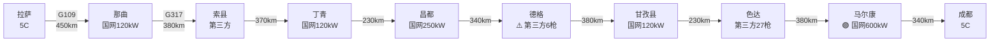

# ⚡ 充电站网络

理想L9 Livis 增程式电动车的充电规划是川藏大环线的核心议题。本页详解全程充电网络、桩型识别、补能策略。

---

## 🎯 核心结论

!!! success "✅ G318川藏南线：理想5C已全线贯通！"
    从康定到拉萨 12+ 座理想5C超充站，**平均 150km 一座**，**最长间隔 220km**（新都桥-理塘）。覆盖：康定、新都桥、理塘、巴塘、芒康、左贡、八宿、波密、林芝、工布江达、拉萨。

!!! warning "⚠️ G317川藏北线：理想5C暂无覆盖"
    G317 目前**理想5C 站点 0 座**。但沿途有：
    - 国网 250kW / **600kW 桩**（马尔康）
    - 比亚迪闪充站（实测 150-200kW）
    - 华为 600kW 桩（实测 150-160kW）
    - **最长间隔**：约 280km（德格段），需重点规划

---

## 📊 充电桩类型速查

| 类型 | 标识 | 峰值功率 | L9 实际 | 时长 | 体验 |
|------|------|----------|---------|------|------|
| <span class="charge-badge charge-5c">理想5C</span> | 🟠 | 520kW | 350-400kW | 8-15分钟 | ⭐⭐⭐⭐⭐ |
| 比亚迪闪充 | 🟢 | 1000kW | 200-400kW | 15-25分钟 | ⭐⭐⭐⭐ |
| 国网250kW | 🔵 | 250kW | 60-90kW | 45-60分钟 | ⭐⭐⭐ |
| 国网600kW | 🟣 | 600kW | 90-120kW | 30-40分钟 | ⭐⭐⭐⭐ |
| 华为600kW | 🟡 | 600kW | 150-160kW | 25-35分钟 | ⭐⭐⭐⭐ |
| 公共120kW | ⚪ | 120kW | 50-60kW | 60-80分钟 | ⭐⭐ |
| <span class="charge-badge charge-normal">第三方慢充</span> | ⚫ | 7-22kW | 7-22kW | 8-12小时 | ⭐ |

---

## 🟢 G318川藏南线（去程）

### 全线理想5C站点

```mermaid
flowchart LR
    A[成都<br/>5C密集] -->|320km| B[雅安蒙山府<br/>🟢5C]
    B -->|135km| C[康定<br/>🟢5C]
    C -->|50km| D[新都桥<br/>🟢5C]
    D -->|290km| E[理塘虫草<br/>🟢5C]
    E -->|250km| F[亚丁<br/>蔚来120kW]
    F -->|210km| G[巴塘弦韵<br/>🟢5C]
    G -->|105km| H[芒康如美<br/>🟢5C]
    H -->|130km| I[左贡悦溪<br/>🟢5C]
    I -->|180km| J[八宿然乌湖<br/>🟢5C]
    J -->|170km| K[波密格拉丹东<br/>🟢5C]
    K -->|230km| L[林芝鲁朗<br/>🟢5C]
    L -->|170km| M[工布江达服务区<br/>🟢5C]
    M -->|130km| N[甘丹寺服务区<br/>🟢5C]
    N -->|30km| O[拉萨<br/>🟢5C]
```



### 详细充电站表

| 序号 | 站点 | 位置 | 桩型 | 备注 |
|------|------|------|------|------|
| 1 | **雅安蒙山府站** | 雅安雨城区 | <span class="charge-badge charge-5c">理想5C</span> | 进藏第一充 |
| 2 | **康定城区站** | 康定新城 | <span class="charge-badge charge-5c">理想5C</span> | 折多山前 |
| 3 | **新都桥可往酒店站** | 新都桥镇 | <span class="charge-badge charge-5c">理想5C</span> | 光影天堂 |
| 4 | **理塘虫草大酒店站** | 理塘县城 | <span class="charge-badge charge-5c">理想5C</span> | 5-10分钟充满 |
| 5 | 稻城明宇丽雅阳光 | 稻城县 | 蔚来120kW | 对外开放 |
| 6 | **巴塘弦韵酒店站** | 巴塘县城 | <span class="charge-badge charge-5c">理想5C</span> | 进藏前最后满电 |
| 7 | **芒康如美温泉大酒店站** | 如美镇 | <span class="charge-badge charge-5c">理想5C</span> | 入藏第一站 |
| 8 | **左贡悦溪度假酒店站** | 左贡县城 | <span class="charge-badge charge-5c">理想5C</span> | |
| 9 | **八宿然乌湖站** | 然乌湖畔 | <span class="charge-badge charge-5c">理想5C</span> | 然乌湖景区 |
| 10 | **波密格拉丹东酒店站** | 波密县城 | <span class="charge-badge charge-5c">理想5C</span> | 气候温暖 |
| 11 | **林芝鲁朗珠江国际酒店站** | 鲁朗小镇 | <span class="charge-badge charge-5c">理想5C</span> | 1×5C + 7×2C |
| 12 | **工布江达服务区站** | G318双向 | <span class="charge-badge charge-5c">理想5C</span> | 高速服务区 |
| 13 | **甘丹寺服务区站** | G318双向 | <span class="charge-badge charge-5c">理想5C</span> | 拉萨前最后一充 |
| 14 | **拉萨城区站** | 拉萨市区 | <span class="charge-badge charge-5c">理想5C</span> | 理想自营 |

### G318补能策略

**建议节奏**：

```
成都（满电）→ 雅安（补一次，10分钟）→ 康定（过夜充满）
→ 新都桥（5C补，10分钟）→ 理塘（5C满充）
→ 亚丁（酒店充）→ 巴塘（5C满）→ 芒康（5C满）
→ 左贡（5C满）→ 八宿（5C满）→ 波密（5C满）
→ 林芝（5C满）→ 工布江达（服务区5C）→ 甘丹寺（服务区5C）→ 拉萨
```

**单次补电间隔最大**：新都桥-理塘 约 290 km（建议中途折多山下山后补电一次，或直奔理塘 5C 站）

---

## 🟣 G317川藏北线（回程）

### 主要充电站分布



### 详细充电站表

| 序号 | 站点 | 位置 | 桩型 | 功率 | 备注 |
|------|------|------|------|------|------|
| 1 | 拉萨城区站 | 拉萨 | <span class="charge-badge charge-5c">理想5C</span> | 520kW | 满电出发 |
| 2 | 那曲充电站 | 那曲市区 | 国网 | 120kW | |
| 3 | 索县充电站 | 索县 | 第三方 | 60-120kW | |
| 4 | 丁青充电站 | 丁青 | 第三方 | 120kW | |
| 5 | **昌都充电站** | 昌都 | 国网 | 120-250kW | **补给充足** |
| 6 | 德格充电站 | 德格 | 第三方 | 120kW | ⚠️ 仅3站6枪 |
| 7 | 甘孜县充电站 | 甘孜 | 国网 | 120kW | 10站30枪 |
| 8 | 色达充电站 | 色达 | 第三方 | 120kW | 9站27枪 |
| 9 | **马尔康高速路口** | 马尔康 | **国网** | **600kW** | 🌟 **北线最强站** |
| 10 | 马尔康维也纳 | 马尔康 | Tesla | 85kW | 对外开放 |
| 11 | **理县服务区** | G317 高速 | <span class="charge-badge charge-5c">理想5C</span> | **520kW + 250kW** | 🌟 **回川惊喜** |
| 12 | 雁门服务区 | 汶川 | 第三方 | 120kW | 10枪 |
| 13 | 成都城区站 | 成都 | <span class="charge-badge charge-5c">理想5C</span> | 520kW | |

### G317补能策略 ⚠️ 重点

**关键原则**：

1. **每站必充**：G317 不确定性大，每次充电都尽量满电
2. **关注低温**：藏区夜间零下，电池预热需时
3. **避开雷雨**：川西雨季雷电多
4. **提前查询**：通过理想App、特来电App、e充电App查询实时状态

**G317 三段难点**：

| 段 | 距离 | 难点 | 策略 |
|----|------|------|------|
| 昌都→德格 | 340km | 充电桩稀缺 | 昌都国网250kW充满，备应急移动充 |
| 德格→甘孜 | 380km | 雀儿山险路 | 雀儿山前补满，山下注意电量 |
| 色达→马尔康 | 380km | 长下坡+低温 | 满电出发，抵达马尔康 600kW 狂补 |

!!! danger "⚠️ 德格段风险"
    德格仅有 3 个充电站 6 把枪，故障率较高。强烈建议：
    1. 昌都出发时 **100% 满电**
    2. 携带理想随车充（应急）
    3. 关注 App 实时状态

---

## 🟡 第一阶段（去程入川）充电

### G4京港澳（皇岗→桂林→贵阳）

| 站点 | 桩型 | 位置 |
|------|------|------|
| 东莞厚街服务区 | <span class="charge-badge charge-5c">理想5C</span> | 双向 |
| 广州北二环服务区 | <span class="charge-badge charge-5c">理想5C</span> | 双向 |
| 曲江服务区 | <span class="charge-badge charge-5c">理想5C</span> | 双向 |
| 郴州服务区 | <span class="charge-badge charge-5c">理想5C</span> | 双向 |
| 衡阳服务区 | <span class="charge-badge charge-5c">理想5C</span> | 双向 |
| 凤凰服务区 | <span class="charge-badge charge-fast">国网250kW</span> | G55二广 |
| 八角寨服务区 | <span class="charge-badge charge-fast">国网250kW</span> | G55二广 |
| 五通服务区 | <span class="charge-badge charge-fast">国网120kW</span> | 桂林段 |
| 桂林两江服务区 | <span class="charge-badge charge-fast">国网120kW</span> | G76厦蓉 |

### G76/G75 桂林→贵阳→重庆

贵州高速服务区充电桩密集，平均 50km 一座。

---

## 🟢 第五阶段（返程东归）充电

### 重庆全境 🟢 5C最密集

- 135 座理想5C服务区
- 平均 33km 一座
- 重点：璧山/大足/铜梁/潼南服务区

### G65 包茂（重庆→张家界）

- 多个理想5C服务区
- 武隆服务区5C密集

### G4 京港澳（长沙→皇岗）

- 理想5C密集覆盖
- 每 100-150km 一座

---

## 📱 必备充电App

| App | 用途 | 推荐指数 |
|-----|------|----------|
| **理想汽车** | 自营5C/超充 | ⭐⭐⭐⭐⭐ |
| **特来电** | 公共桩覆盖广 | ⭐⭐⭐⭐⭐ |
| **星星充电** | 万帮新能源 | ⭐⭐⭐⭐⭐ |
| **国家电网（e充电）** | 国网桩 | ⭐⭐⭐⭐ |
| **小桔充电** | 滴滴旗下 | ⭐⭐⭐⭐ |
| **开迈斯** | 大众/宝马合资 | ⭐⭐⭐ |

---

## 💡 补能小贴士

### 理想L9 Livis 充电特性

!!! tip "🔋 电池参数"
    - 容量：44.5 kWh
    - 快充功率：峰值 110kW（5C站可达更高）
    - 慢充功率：7kW
    - 10-80% SOC 充电时间：约 30-40 分钟
    - 纯电续航：CLTC 235km，实际高速约 180-200km

### 增程器使用建议

```
电量 < 25%：增程器自动启动（最佳效率区间 25-75%）
电量 < 15%：强制增程（保护电池）
海拔 > 4000m：建议保电 50% 以上（应对寒冷和应急）
```

### 高原充电注意事项

1. **电池预热**：川藏线早晨温度低，先开暖风 5-10 分钟预热电池
2. **避开雷暴**：高原天气多变，遇雷雨推迟充电
3. **多站补电**：不要等电量 10% 以下才找桩
4. **关注App**：实时查看桩状态、排队情况
5. **错峰充电**：抵达酒店后立即充电，避免早晨离开前排队

---

## ⏭️ 下一步

- 🏔️ 查看 [高反与健康](health.md)
- 🟢 查看 [第二阶段·G318](stage-2-g318.md)
- 🟣 查看 [第四阶段·G317](stage-4-g317.md)
