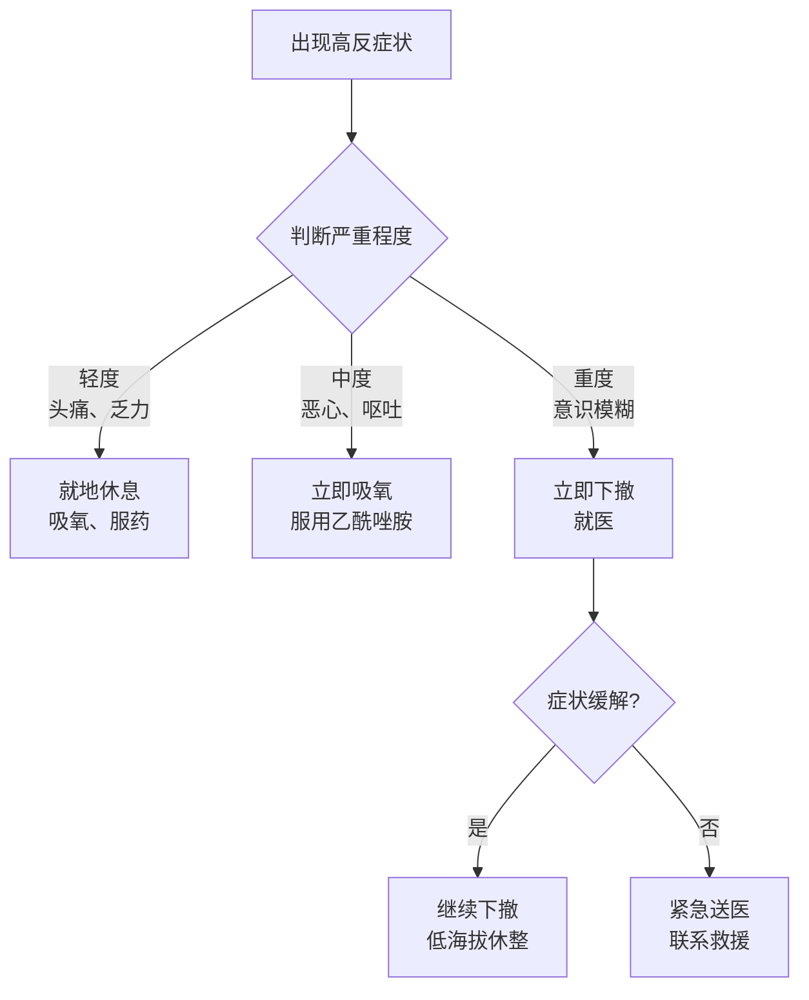
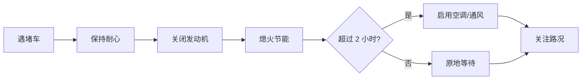

# 🆘 应急与救援

本页提供全程可能遇到的紧急情况应对方案、关键救援电话、保险建议。

---

## 🚨 紧急电话

### 全国通用

| 用途 | 电话 | 备注 |
|------|------|------|
| **报警** | **110** | 治安、刑事 |
| **医疗急救** | **120** | 伤病 |
| **交通事故** | **122** | 车祸 |
| **高速救援** | **12122** | 高速事故 |
| **森林消防** | **12119** | 森林火警 |
| **理想汽车救援** | **400-686-9999** | 7×24 小时 |
| **国家电网客服** | **95598** | 充电桩问题 |
| **特来电客服** | **4001-555-555** | 充电桩问题 |
| **雪鹰航空救援** | **400-816-0999** | 直升机救援 |

### 沿途城市医疗资源

| 城市 | 医院 | 类型 | 备注 |
|------|------|------|------|
| 桂林 | 桂林医学院附属医院 | 三甲 | |
| 贵阳 | 贵州省人民医院 | 三甲 | |
| 成都 | 四川大学华西医院 | **顶级三甲** | 川藏线最大保障 |
| 雅安 | 雅安市人民医院 | 三甲 | |
| 康定 | 甘孜州人民医院 | 三乙 | |
| 拉萨 | 西藏自治区人民医院 | **三甲** | 西藏最权威 |
| 日喀则 | 日喀则市人民医院 | 三甲 | |
| 昌都 | 昌都市人民医院 | 三乙 | |
| 林芝 | 林芝市人民医院 | 三乙 | |
| 长沙 | 中南大学湘雅医院 | **顶级三甲** | |
| 张家界 | 张家界市人民医院 | 三甲 | |

### 高原救援特殊资源

| 资源 | 联系方式 | 备注 |
|------|----------|------|
| 拉萨雪鹰救援 | 400-816-0999 | 川藏线直升机救援 |
| 西藏红十字会 | 0891-6334193 | |
| 高反急救中心（拉萨） | 0891-6371370 | 24小时 |

---

## 🏔️ 高反急救

### 急救步骤

### 急救药物清单

| 药品 | 用途 | 用量 | 注意事项 |
|------|------|------|----------|
| 芬必得 | 高反头痛 | 1 粒 | 不可长期 |
| 乙酰唑胺 | 急性高反 | 125-250mg | 医嘱下使用 |
| 硝苯地平 | 肺水肿 | 10mg 舌下 | 急救用 |
| 地塞米松 | 重度高反 | 4-8mg | 激素，慎用 |
| 红景天 | 预防 | 每日 2-3 次 | 提前 5-7 天 |
| 葡萄糖 | 补能 | 30g 冲水 | 每日 1-2 次 |
| 生理盐水 | 补水 | 500ml 静滴 | 严重时使用 |

### 立即下撤信号

!!! danger "🚨 以下情况立即下撤"
    - 静息时血氧 < 70%
    - 意识模糊
    - 咳粉红色泡沫痰
    - 走路不稳（共济失调）
    - 持续高烧不退
    - 持续呕吐不能进食
    - **每多待 1 小时都是赌命**

---

## 🚗 车辆故障

### 理想L9 Livis 常见问题

| 问题 | 应急处理 | 后续 |
|------|----------|------|
| **电量耗尽** | 启用强制保电 / 增程器 | 找最近充电桩 |
| **轮胎扎钉** | 补胎工具 / 备胎 | 缓慢行驶到修理厂 |
| **刹车失灵** | 降挡 / 手刹 | 立即靠边 |
| **增程器故障** | 致电 400-686-9999 | 等待救援 |
| **电池故障** | 立即停车 | 等待救援 |
| **车门锁死** | 机械钥匙 | 4S 店处理 |
| **空调故障** | 开窗 | 不影响行驶 |

### 自救步骤

1. **保持冷静**
2. 靠边停车（应急车道或宽阔地）
3. 开启双闪
4. 摆放三角牌（150米外）
5. 人员撤离至护栏外
6. 拨打救援电话

---

## 🌧️ 恶劣天气应对

### 雨季（5-9月，**本行程 10-11 月避开**）

- 关注天气预报
- 备好雨具
- 减速慢行
- 避让山体滑坡

### 冬季（11-3月，**本行程 11 月初**）

- 关注路面结冰
- **G317 高海拔段可能封路**
- 备好防滑链
- 关注交通管制信息

### 雪天/冰雹

- 减速
- 不急刹车
- 保持安全距离
- 必要时挂防滑链

---

## 🚧 道路突发情况

### 常见风险

| 风险 | 多发段 | 应对 |
|------|--------|------|
| 落石 | G317 高山段 | 不在崖下停留 |
| 塌方 | 雨季 | 关注路况 |
| 暗冰 | 阴山段 | 减速慢行 |
| 涉水 | 暴雨后 | 不冒险通过 |
| 高山反应 | 4000m+ | 监测血氧 |
| 动物穿行 | 草原段 | 减速让行 |

### 堵车应对

!!! tip "💡 堵车小贴士"
    - 川藏线偶有堵车（事故、塌方）
    - 关闭发动机省油
    - 准备好食物和水
    - 关注"高德路况"
    - 必要时询问当地司机

---

## 📡 通讯失联

### 信号覆盖

- **G318主段**：基本覆盖
- **G317部分段**：信号差或无
- **无人区**：完全无信号

### 应急通讯

| 设备 | 推荐 | 费用 |
|------|------|------|
| **卫星电话** | 铱星 / 舒拉亚 | 1000+ 元/天 |
| **卫星通信器** | 华为 Mate 60 Pro | 6000+ |
| **北斗短报文** | 部分手机 | 免费 |
| **海事卫星** | 备选 | 贵 |

### 应急方案

1. **告知行程**：出发前向家人报备每日路线
2. **约定频率**：每日固定时间发位置
3. **下载离线地图**：高德、百度
4. **携带应急包**：哨子、反光镜、便携充电

---

## 🩹 受伤处置

### 创伤救护

| 伤情 | 应急处理 |
|------|----------|
| 擦伤 | 生理盐水冲洗 + 碘伏 + 创可贴 |
| 切割伤 | 加压止血 + 包扎 + 就医 |
| 骨折 | 夹板固定 + 不移动 + 就医 |
| 烧伤 | 冷水冲洗 + 湿润烧伤膏 |
| 动物咬伤 | 肥皂水冲洗 + 狂犬疫苗 |

### 常用急救包

- [ ] 创可贴（多规格）
- [ ] 医用纱布
- [ ] 医用胶带
- [ ] 碘伏 / 酒精棉片
- [ ] 生理盐水
- [ ] 三角巾
- [ ] 绷带
- [ ] 烧伤膏
- [ ] 红花油 / 活络油
- [ ] 退烧贴
- [ ] 体温计
- [ ] 一次性手套
- [ ] 口罩
- [ ] 消毒湿巾

---

## 🏥 重大疾病

### 心血管

- 速效救心丸
- 硝酸甘油
- 阿司匹林

### 脑血管

- 安宫牛黄丸（黄金 4.5 小时）
- 立即送医

### 急性高原病

- 立即吸氧
- 立即下撤
- 紧急送医

### 食物中毒

- 催吐
- 蒙脱石散
- 口服补液盐
- 就医

---

## 📞 保险与救援服务

### 推荐保险

| 险种 | 保险公司 | 保额 | 价格 | 推荐 |
|------|----------|------|------|------|
| **旅游意外险** | 平安 / 美亚 | 100 万 | 100-200 元 | ⭐⭐⭐⭐⭐ |
| **高原险** | 美亚 | 30 万 | 50-100 元 | ⭐⭐⭐⭐⭐ |
| **航空救援险** | 中国人保 | 500 万 | 300-500 元 | ⭐⭐⭐⭐ |
| **车险全险** | — | 100 万 | 已购 | ⭐⭐⭐⭐⭐ |

### 直升机救援

- 拉萨雪鹰救援：☎️ **400-816-0999**
- 服务范围：川藏线、青藏线、新藏线
- 费用：5-20 万元 / 次
- **保险含航空救援可全额报销**

### 理想汽车救援服务

- 基础救援：免费（道路救援、紧急充电）
- 拖车服务：200km 内免费
- 异地住宿：每日最高 800 元
- 备用车：提供

---

## ⏭️ 下一步

- 🎒 查看 [装备清单](gear.md) 复盘
- 🏔️ 查看 [高反与健康](health.md)
- 🎉 回到 [首页](index.md)
