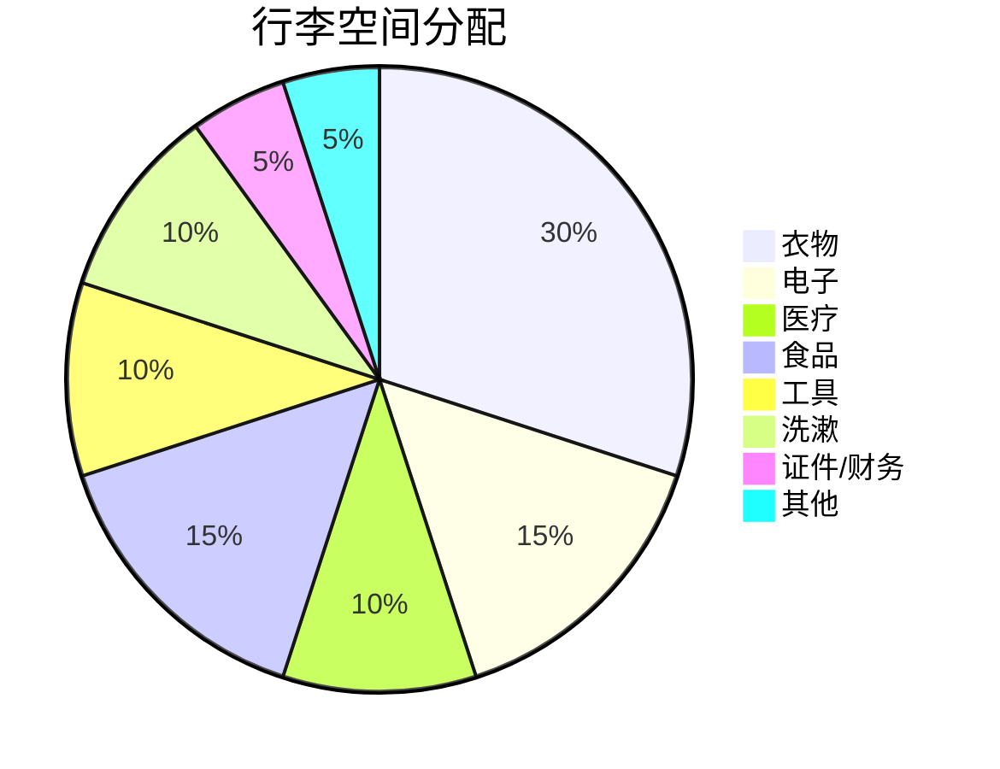

# 🎒 装备清单

完整的车辆、衣物、电子、医疗、食物装备清单及打包建议。

---

## 🚗 车辆装备（理想L9 Livis）

### 随车工具

- [ ] 车载充气泵（带压力表）
- [ ] 补胎工具包（6 件套）
- [ ] 拖车绳（5 吨级，长 5 米）
- [ ] 搭电宝（12V 应急启动）
- [ ] 应急启动电源（锂电池）
- [ ] 千斤顶（2 吨级）
- [ ] 套筒扳手套装
- [ ] 螺丝刀（十字、一字）
- [ ] 尖嘴钳
- [ ] 活动扳手
- [ ] 电工胶带
- [ ] 备用保险丝（多型号）
- [ ] 12V→220V 逆变器（800W+）
- [ ] 插线板（多孔）
- [ ] 工作手套
- [ ] 头灯（双手解放）

### 理想L9 Livis 专用

- [ ] 充电枪（原厂随车充）
- [ ] Type 2 转接头
- [ ] 充电线收纳包
- [ ] 车内空气净化器滤芯（备用）
- [ ] 雨伞（车用）

### 备件

- [ ] 备胎（**G317 段重要！**）
- [ ] 机油（1L 备用，理想原厂）
- [ ] 玻璃水（防冻型，2 瓶）
- [ ] 冷却液（1L 备用）
- [ ] 火花塞（增程器，如已用 4 万 km）

---

## 👕 衣物清单

### 上装

| 衣物 | 数量 | 用途 |
|------|------|------|
| 羽绒服（800+蓬） | 1 | 高原夜间零下 |
| 冲锋衣（防水） | 1 | 防风防雨 |
| 抓绒衣 | 1 | 中间保暖层 |
| 保暖内衣（美利奴） | 2套 | -10℃ ~ 15℃ |
| 速干T恤 | 5 | 内穿 |
| 卫衣 | 2 | 休闲穿着 |
| 衬衫 | 1 | 城市 |
| 短袖 | 3 | 南方段 |

### 下装

| 衣物 | 数量 | 用途 |
|------|------|------|
| 冲锋裤（防水） | 1 | 高原徒步 |
| 保暖裤 | 1 | 高原夜间 |
| 牛仔裤 | 1 | 城市 |
| 休闲裤 | 2 | 城市 |
| 速干裤 | 1 | 运动 |
| 内裤 | 8 | 速干 |
| 泳裤 | 1 | 温泉酒店 |

### 配件

- [ ] 保暖帽（毛线/羽绒）
- [ ] 遮阳帽（防晒）
- [ ] 防晒袖套
- [ ] 围巾/围脖
- [ ] 保暖手套（防风）
- [ ] 触屏手套
- [ ] 袜子（美利奴）8双
- [ ] 鞋垫（吸汗）
- [ ] 登山鞋（防水，1双）
- [ ] 休闲鞋（1双）
- [ ] 拖鞋（1双）

---

## 🔌 电子产品

### 通讯

- [ ] **手机**（主+备）2 部
- [ ] 充电宝（**20000mAh × 2**，不可托运）
- [ ] 数据线（Type-C、Lightning、USB）
- [ ] 快充头（多口 65W+）
- [ ] 车载充电器（双口快充）
- [ ] SIM卡（主卡 + 备用）
- [ ] 对讲机（**2 部**，车队必备）

### 摄影

- [ ] **相机**（单反/微单）
- [ ] **广角镜头**（16-35mm）
- [ ] **长焦镜头**（70-200mm）
- [ ] **中焦镜头**（24-70mm）
- [ ] 三脚架
- [ ] **无人机**（DJI Mavic 3 Pro）
- [ ] 多张 SD卡（128G+）
- [ ] GoPro（可选）
- [ ] 相机清洁套装
- [ ] 备用电池（多块）
- [ ] 充电器

### 导航

- [ ] **高德地图**（最新版 + 离线包）
- [ ] 百度地图（备用）
- [ ] 两步路户外助手
- [ ] OBD 智能车机
- [ ] **离线地图包**（川藏线）
- [ ] 纸质地图（备用）

### 娱乐

- [ ] 蓝牙耳机
- [ ] 便携音箱
- [ ] Kindle（电子书）
- [ ] iPad
- [ ] 扑克牌
- [ ] 桌游

### 工具

- [ ] 笔记本 + 笔
- [ ] 旅行日记本
- [ ] 标签贴（行李标记）

---

## 💊 医疗药品

### 高反类（必带）

- [ ] 红景天胶囊（**4 盒**）
- [ ] 葡萄糖粉（**3 盒**）
- [ ] 芬必得（布洛芬）3 盒
- [ ] **乙酰唑胺**（Diamox，**需医嘱**）
- [ ] **氧气袋 × 2**（关键！）
- [ ] **便携式血氧仪**（必备）
- [ ] 速效救心丸
- [ ] 硝酸甘油
- [ ] 地塞米松（**需医嘱**）

### 常用药

- [ ] 感冒药（白加黑、康泰克）
- [ ] 退烧药（对乙酰氨基酚）
- [ ] 止泻药（蒙脱石散、整肠丸）
- [ ] 胃药（奥美拉唑）
- [ ] 晕车药（茶苯海明）
- [ ] 抗过敏药（氯雷他定）
- [ ] 安眠药（褪黑素）
- [ ] 创可贴（多规格）
- [ ] 碘伏 + 棉签
- [ ] 纱布 + 医用胶带
- [ ] 烧伤膏（湿润烧伤膏）
- [ ] 云南白药喷雾
- [ ] 风油精、清凉油
- [ ] 眼药水（人工泪液）
- [ ] 润唇膏（防晒型）
- [ ] 抗高原反应眼药水

### 慢性病/特殊

!!! warning "⚠️ 个人药品必带"
    - 高血压：降压药（**充足**）
    - 糖尿病：胰岛素 + 血糖仪
    - 心脏：速效救心丸、硝酸甘油
    - 哮喘：沙丁胺醇吸入剂
    - 其他：个人长期用药

---

## 🍞 食品物资

### 必备

- [ ] **瓶装水**（每日 3-4L，30 天共 100L，沿途补给）
- [ ] **能量棒**（20+ 根）
- [ ] **巧克力**（士力架、KitCat）
- [ ] **坚果**（每日 1 包）
- [ ] **牛肉干/猪肉脯**
- [ ] **压缩饼干**（应急）
- [ ] **泡面/自热饭**（堵车应急）
- [ ] **咖啡/茶包**
- [ ] **葡萄糖粉**（多备）
- [ ] **电解质冲剂**（宝矿力粉）
- [ ] **维生素 C**（泡腾片）
- [ ] **奶粉**（备用）

### 可选

- [ ] 苹果、橙子
- [ ] 面包、蛋糕
- [ ] 八宝粥
- [ ] 奶茶粉
- [ ] 少量白酒
- [ ] 罐头

---

## 💰 财务物品

### 现金

- [ ] **现金 3000-5000 元**（小面额）
- [ ] 钱包
- [ ] 钱夹

### 支付

- [ ] **微信支付**（绑定银行卡）
- [ ] **支付宝**（绑定银行卡）
- [ ] **云闪付**
- [ ] **信用卡**（1-2 张）
- [ ] **加油卡**（中石油、中石化）
- [ ] **充电卡**（国网、特来电、星星充电）

### 证件

- [ ] **身份证**（**原件** + 复印件 2 份）
- [ ] **驾驶证**（原件 + 复印件）
- [ ] **行驶证**（原件 + 复印件）
- [ ] **保险单**（电子+纸质）
- [ ] **边防证**
- [ ] 港澳通行证（如去香港）
- [ ] 护照（如去尼泊尔）
- [ ] 户口本复印件（部分酒店登记）

---

## 🏠 生活用品

### 洗漱

- [ ] 牙刷 + 牙膏
- [ ] 毛巾（快干）
- [ ] 浴巾
- [ ] 洗发水（旅行装）
- [ ] 沐浴露（旅行装）
- [ ] 护发素
- [ ] 洗面奶
- [ ] 护肤品（旅行装）
- [ ] 化妆品
- [ ] 梳子
- [ ] 剃须刀
- [ ] 卫生巾（女性）

### 卫生

- [ ] 纸巾（多包）
- [ ] 湿巾
- [ ] 消毒湿巾
- [ ] 垃圾袋
- [ ] 一次性马桶垫
- [ ] 口罩（N95 备 20 个）
- [ ] 免洗洗手液
- [ ] 鞋套（雨季）

### 睡眠

- [ ] 颈枕（记忆棉）
- [ ] 眼罩
- [ ] 耳塞
- [ ] 旅行睡袋（备用）

---

## 📦 行李打包建议

### 打包原则

### 理想L9 行李分配

- **后备箱底层**：工具、备胎、应急食品、氧气袋
- **后备箱中层**：衣物、洗漱、医疗
- **后备箱上层**：电子、摄影、充电设备
- **车顶（行李架）**：帐篷、防潮垫（如有）
- **前排副驾**：常用物品、急救包
- **后排**：儿童用品（如有）、零食、颈枕

### 必备随身包

- [ ] 身份证
- [ ] 驾驶证
- [ ] 边防证
- [ ] 现金 500 元
- [ ] 手机 + 充电宝
- [ ] 墨镜
- [ ] 帽子
- [ ] 保温水壶
- [ ] 红景天
- [ ] 芬必得
- [ ] 氧气袋
- [ ] 厚外套
- [ ] 零食

---

## 🌟 装备清单速查表

### 必带指数 ⭐⭐⭐⭐⭐

| 物品 | 必带 | 数量 |
|------|------|------|
| 身份证 | ✅ | 1 |
| 边防证 | ✅ | 1 |
| 驾驶证 | ✅ | 1 |
| 现金 3000+ | ✅ | — |
| 氧气袋 | ✅ | 2 |
| 血氧仪 | ✅ | 1 |
| 红景天 | ✅ | 4 盒 |
| 充电器 | ✅ | 2 个 |
| 充电线 | ✅ | 多根 |
| 充电宝 | ✅ | 2 个 |
| 羽绒服 | ✅ | 1 件 |
| 冲锋衣 | ✅ | 1 件 |
| 墨镜 | ✅ | 1 副 |
| 防晒霜 | ✅ | 1 瓶 |
| 备胎 | ✅ | 1 |
| 补胎工具 | ✅ | 1 套 |
| 拖车绳 | ✅ | 1 |

### 强烈推荐 ⭐⭐⭐⭐

| 物品 | 推荐 | 数量 |
|------|------|------|
| 无人机 | ✅ | 1 |
| 单反相机 | ✅ | 1 |
| 长焦镜头 | ✅ | 1 |
| 对讲机 | ✅ | 2 |
| 三脚架 | ✅ | 1 |
| 颈枕 | ✅ | 1 |
| 眼罩耳塞 | ✅ | 1套 |
| 保温水壶 | ✅ | 1 |
| 能量棒 | ✅ | 20+ |
| 巧克力 | ✅ | 10+ |
| 速效救心丸 | ✅ | 1 盒 |
| 创可贴 | ✅ | 多 |

### 可选 ⭐⭐⭐

| 物品 | 用途 |
|------|------|
| GoPro | 自驾记录 |
| 帐篷 | 星空露营 |
| 睡袋 | 应急 |
| 吊床 | 休息 |
| 户外桌椅 | 露营 |
| 蓝牙音箱 | 娱乐 |
| Kindle | 阅读 |
| iPad | 追剧 |

---

## 📋 行前最终检查

### 出发前 1 周

- [ ] 边防证办理完毕
- [ ] 车辆保养完毕
- [ ] 衣物准备完毕
- [ ] 药品购买完毕
- [ ] 证件确认齐全
- [ ] 现金取出

### 出发前 1 天

- [ ] 充电满电
- [ ] 油量加满
- [ ] 胎压正常
- [ ] 行李装车
- [ ] 应急包就位
- [ ] 食物装车
- [ ] 关闭家中水电气
- [ ] 家人朋友报备

### 出发当天

- [ ] 携带随身包
- [ ] 启动车辆
- [ ] 开启导航
- [ ] 开启行程记录
- [ ] 享受旅程！

---

## ⏭️ 下一步

- 🎉 回到 [首页](index.md)
- 🆘 临时需要？查看 [应急与救援](emergency.md)
