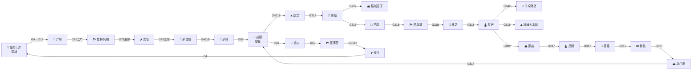

---
hide:
  - navigation
  - toc
---

# 🚗 G318/G317 川藏大环线电子路书

<h1 style="color: white;">理想 L9 Livis · 30天 · 8,800公里</h1>

深圳皇岗 ⇄ 成都 ⇄ 拉萨 ⇄ 深圳皇岗 · G318进 G317出

2026年10月19日 — 2026年11月19日

---

## 📊 行程总览

30

天数

8,800

公里

14

国家高速

5

国家国道

5,248

最高海拔(米)

15+

核心充电站

---

## 🗺️ 路线一览

---

## 🛣️ 核心道路编号

### 国家高速

| 编号 | 名称 | 路段 |
|------|------|------|
| G4 | 京港澳 | 皇岗⇄广州⇄长沙 |
| G4218 | 雅康 | 雅安→康定 |
| G4215 | 蓉遵 | 仁怀→泸州→成都 |
| G93 | 成渝环线 | 成都⇄重庆 |
| G65 | 包茂 | 重庆→武隆→张家界 |
| G5513 | 长张 | 长沙→张家界 |
| G76 | 厦蓉 | 桂林→贵阳 |
| G75 | 兰海 | 贵阳→遵义→重庆 |
| G55 | 二广 | 清远→怀化→桂林 |

### 国家国道

| 编号 | 名称 | 路段 | 角色 |
|------|------|------|------|
| G318 | 沪聂线 | 成都→康定→理塘→芒康→然乌→林芝→拉萨 | 🟢 **去程主线** |
| G317 | 成那线 | 成都→马尔康→色达→德格→昌都→那曲→拉萨 | 🟣 **回程主线** |
| G227 | 张孟线 | 理塘→稻城→亚丁 | 🟢 亚丁绕道 |
| G109 | 京拉线 | 拉萨→当雄→那曲 | 🟣 G317前置段 |
| G349 | 察芒线 | 拉萨→羊湖→日喀则 | 🟢 羊湖支线 |

---

## 📑 章节导航

### 🧭 准备篇
- **[行程总览](overview.md)** - 30天分阶段、每日要点
- **[行前准备](preparation.md)** - 边防证、装备、药品、车辆整备
- **[路线与道路编号](routes.md)** - 全程路网详细解读
- **[充电站网络](charging.md)** - 理想5C覆盖、第三方桩分布
- **[高反与健康](health.md)** - 高原反应预防与应对

### 🛣️ 行程篇
- **[第一阶段 · 南行入川](stage-1-south.md)** - 皇岗→桂林→贵阳→成都（5天）
- **[第二阶段 · G318川藏南线](stage-2-g318.md)** - 成都→康定→理塘→亚丁→林芝→拉萨（9天）
- **[第三阶段 · 拉萨与延伸](stage-3-lhasa.md)** - 拉萨→羊湖→珠峰（5天）
- **[第四阶段 · G317川藏北线](stage-4-g317.md)** - 拉萨→那曲→昌都→色达→马尔康（8天）
- **[第五阶段 · 凯旋东归](stage-5-return.md)** - 成都→重庆→张家界→长沙→皇岗（3天）

### 🆘 实用篇
- **[应急与救援](emergency.md)** - 紧急电话、救援、保险
- **[装备清单](gear.md)** - 车辆、衣物、电子产品、医疗
- **[关于](about.md)** - 路书说明、技术栈、致谢

---

## ⚡ 核心亮点

!!! tip "💡 G318 理想5C已全线贯通"
    G318川藏南线全程已有12+座理想5C超充站，**从康定到拉萨一路5C不断电**！包括新都桥、理塘、巴塘、芒康、左贡、八宿、波密、林芝、工布江达等关键节点。

!!! warning "⚠️ G317理想5C暂无覆盖"
    G317川藏北线目前理想5C尚未覆盖，但沿途有 **国网 250kW / 600kW 桩 + 比亚迪闪充站**。建议在马尔康（**600kW超充**）和理县服务区（**520kW理想5C**）满电出发。

!!! danger "🚨 高原风险提示"
    行程最高点珠峰 **嘉措拉山口 5248m**。全程 5000m+ 垭口多达 6 个。请务必：
    1. 提前 5-7 天服用红景天
    2. 备足氧气袋和便携式血氧仪
    3. 行程节奏不可过赶
    4. 出现严重高反立即下撤

---

## 🎬 立即开始

- 新手请先阅读 **[行前准备](preparation.md)**
- 关注路况请查看 **[充电站网络](charging.md)** 和 **[高反与健康](health.md)**
- 关注风景请查看 **[第二阶段·G318](stage-2-g318.md)** 和 **[第三阶段·拉萨](stage-3-lhasa.md)**

**愿此路平安，山河无恙！🏔️✨**
