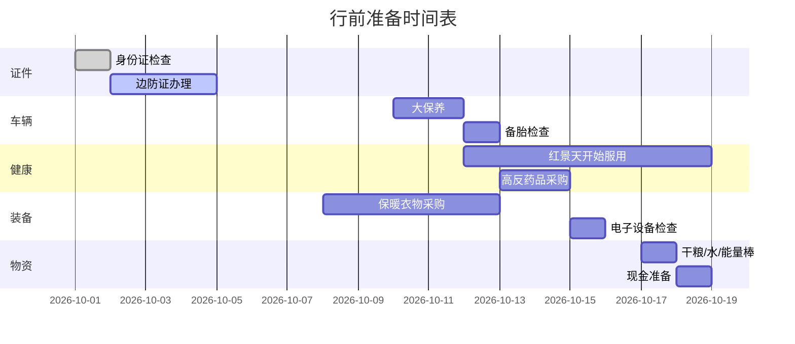

# 🎒 行前准备

本页提供完整的 30 天川藏大环线行前准备清单，按优先级分章节组织。

---

## 📋 准备时间表



---

## 🆔 证件清单

<div class="day-card">

### ✅ 必备证件（出发前必带）

- [ ] **身份证原件**（必备，过检查站必查）
- [ ] **驾驶证**（C1及以上）
- [ ] **行驶证**（车辆必备）
- [ ] **车辆保险单**（电子+纸质）
- [ ] **边防证**（珠峰、亚丁部分区域必需）⬅️ **重点**

</div>

### 🚨 边防证办理详解

**为什么需要？**

边防证是进入中印、中尼、中缅边境地区的合法凭证。以下区域必须持证：

- 珠穆朗玛峰自然保护区
- 日喀则地区（部分）
- 山南地区（部分）
- 林芝地区（墨脱等）

**在哪里办？**

| 办理地点 | 地址 | 耗时 | 推荐 |
|----------|------|------|------|
| **成都公安局出入境** | 高新南区天府二街 | 当天 | ⭐⭐⭐⭐⭐ |
| 户籍地派出所 | — | 7-15天 | ⭐⭐ |
| 拉萨政务中心 | 城关区 | 当天 | ⭐⭐⭐⭐ |
| 沿途日喀则 | — | 当天 | ⭐⭐⭐ |

**所需材料**：

1. 身份证原件
2. 复印件1份
3. 行驶证复印件
4. 1寸照片2张

**边防证需注明（建议手写覆盖全部）**：

```
西藏自治区：日喀则地区（珠峰）、林芝地区、山南地区
四川省：甘孜州（色达部分区域）
```

!!! warning "⏰ 边防证有效期"
    一般为 **3个月**，必须在有效期内使用。建议出发前 1-2 周办理，避免临时加急。

!!! tip "💡 省钱技巧"
    成都办理是免费的，户籍地某些派出所会收取 10-20 元工本费。

---

## 🚗 车辆整备（理想L9 Livis）

### 🔧 大保养项目（10月10日前完成）

- [ ] **机油机滤更换**（理想原厂全合成）
- [ ] **空气滤清器**检查
- [ ] **刹车片**检查（前后）
- [ ] **轮胎检查**：
  - 胎压（2.5-2.8 bar 适宜长途）
  - 磨损程度（建议 5 万 km 以上更换）
  - 备胎（重要！G317段偏远）
- [ ] **底盘护板**检查（西藏段碎石多）
- [ ] **玻璃水**加满（专用防冻型）
- [ ] **冷却液**检查
- [ ] **增程器机油**（如已到周期）
- [ ] **电池组检查**（理想售后）
- [ ] **空调滤芯**更换（高原灰尘大）

### 🛠️ 必备随车工具

- [ ] 车载充气泵
- [ ] 补胎工具包
- [ ] 拖车绳（5吨级）
- [ ] 搭电宝
- [ ] 应急启动电源
- [ ] 千斤顶 + 套筒
- [ ] 螺丝刀套装
- [ ] 尖嘴钳、扳手
- [ ] 电工胶带
- [ ] 备用保险丝（多型号）
- [ ] 12V→220V逆变器（800W+）
- [ ] 插线板（多孔）

### ⚡ 充电设备

- [ ] 理想L9原厂随车充
- [ ] Type 2 转接头（备用）
- [ ] 充电卡（国网、特来电、星星充电）
- [ ] 充电App：理想汽车、特来电、星星充电、国家电网（e充电）

!!! tip "🔋 理想5C vs 国网桩"
    - **理想5C**：峰值 520kW，10-15 分钟充满
    - **国网250kW桩**：约 60-90kW 实际功率
    - **比亚迪闪充**：L9 可拉 150-200kW
    - **建议**：在有 5C 的站点尽量补满，避免依赖第三方桩

---

## 💊 健康与药品

### 🏔️ 高反预防（重点！）

| 药品/物品 | 用途 | 用法 | 必带 |
|-----------|------|------|------|
| **红景天胶囊** | 预防高反 | 出发前 5-7 天开始服用，每日 2-3 粒 | ⭐⭐⭐⭐⭐ |
| **葡萄糖粉** | 快速补能 | 冲水饮用，每日 1-2 次 | ⭐⭐⭐⭐ |
| **芬必得** | 高反头痛 | 头痛时 1 粒 | ⭐⭐⭐⭐ |
| **氧气袋（2个）** | 应急补氧 | 高反严重时使用 | ⭐⭐⭐⭐⭐ |
| **便携式血氧仪** | 监测血氧 | 每日 2-3 次 | ⭐⭐⭐⭐ |
| **乙酰唑胺（Diamox）** | 急性高反 | 医生指导下使用 | ⭐⭐⭐ |
| **硝苯地平** | 高反肺水肿 | 仅急救 | ⭐⭐ |

### 🤕 常用药品

- [ ] 感冒药（白加黑、康泰克）
- [ ] 退烧药（对乙酰氨基酚）
- [ ] 止泻药（蒙脱石散、整肠丸）
- [ ] 胃药（奥美拉唑）
- [ ] 晕车药（茶苯海明）
- [ ] 抗过敏药（氯雷他定）
- [ ] 创可贴 + 碘伏 + 纱布
- [ ] 烫伤药（湿润烧伤膏）
- [ ] 云南白药喷雾
- [ ] 风油精、清凉油
- [ ] 眼药水（人工泪液）
- [ ] 润唇膏（高原干燥）

### 🦠 个人特殊药品

!!! warning "⚠️ 慢性病必带"
    - 高血压患者：降压药（充足）
    - 糖尿病患者：胰岛素 + 血糖仪
    - 心脏疾病：速效救心丸、硝酸甘油
    - 哮喘患者：沙丁胺醇吸入剂

---

## 👕 衣物清单

### 🧥 核心服装

| 衣物 | 数量 | 用途 |
|------|------|------|
| **羽绒服（800+蓬）** | 1件 | 高原夜间零下必备 |
| **冲锋衣（防水）** | 1件 | 防风防雨 |
| **抓绒衣** | 1件 | 中间保暖层 |
| **保暖内衣（美利奴）** | 2套 | -10℃ ~ 15℃ |
| **速干T恤** | 5件 | 内穿 |
| **休闲长裤** | 2条 | 城市穿着 |
| **冲锋裤** | 1条 | 高原徒步 |
| **牛仔裤** | 1条 | 备用 |
| **保暖帽** | 1个 | 头部保暖 |
| **遮阳帽** | 1个 | 防晒 |
| **手套（防风保暖）** | 1双 | -10℃+ |
| **围巾** | 1条 | 防风 |
| **袜子（美利奴）** | 8双 | 速干 |
| **登山鞋** | 1双 | 防水 |
| **拖鞋** | 1双 | 酒店内 |
| **泳衣** | 1件 | 温泉酒店 |

### 👓 配件

- [ ] **墨镜**（偏光，必备，紫外线强）
- [ ] **防晒霜**（SPF50+ PA++++，必备）
- [ ] **唇膏**（防晒型）
- [ ] **保温水壶**（1L+）
- [ ] **颈枕**（长途车用）

---

## 🔌 电子产品

### 📱 通讯

- [ ] **手机**（主+备）— 主手机畅通，备机为旧机
- [ ] **充电宝**（20000mAh×2，**不能托运**）
- [ ] **数据线**（Type-C、Lightning、USB）
- [ ] **快充头**（多口 65W+）
- [ ] **车载充电器**（双口快充）
- [ ] **SIM卡**：
  - 主卡：中国移动/电信全国流量
  - 备用：可短期办理西藏本地卡（拉萨移动有本地套餐）

### 📷 影像

- [ ] **相机**（单反/微单）— 风光大片
- [ ] **广角镜头**（16-35mm）
- [ ] **长焦镜头**（70-200mm）— 雪山、野生动物
- [ ] **三脚架**（夜景、星空）
- [ ] **无人机**（DJI Mavic系列，**注意禁飞区**）
- [ ] **SD卡**（多张，128G+）
- [ ] **GoPro**（自驾记录，可选）

### 🗺️ 导航

- [ ] **高德地图**（最新版，离线包）
- [ ] **百度地图**（备用）
- [ ] **两步路户外助手**（徒步轨迹）
- [ ] **六只脚**（户外记录）
- [ ] **OBD智能车机**（理想自带）
- [ ] **离线地图包**（川藏线、藏区）

### 🎵 娱乐

- [ ] **蓝牙耳机**
- [ ] **便携音箱**（露营用）
- [ ] **Kindle**（电子书）
- [ ] **iPad**（追剧、车上看片）

!!! warning "📵 无人机禁飞区"
    以下区域**禁止**飞行：
    - 拉萨市区、贡嘎机场周边
    - 珠峰大本营（边境敏感）
    - 纳木措部分区域
    - 军用设施周边
    - 起飞前务必查询当地规定！

---

## 🍞 食品物资

### 🥤 必备

- [ ] **瓶装水**（每日 3-4L，30天共 100L，可在沿途补给）
- [ ] **能量棒**（20根+）
- [ ] **巧克力**（士力架、KitKat）
- [ ] **坚果**（每日1包）
- [ ] **牛肉干/猪肉脯**
- [ ] **压缩饼干**（应急）
- [ ] **泡面/自热饭**（堵车应急）
- [ ] **咖啡/茶包**（提神）
- [ ] **葡萄糖粉**（多备，2盒）
- [ ] **电解质冲剂**（宝矿力水特粉）
- [ ] **维生素C**（泡腾片，10片+）

### 🍎 可选

- [ ] 水果（苹果、橙子，易保存）
- [ ] 面包、蛋糕
- [ ] 奶茶粉、咖啡
- [ ] 酒类（少量，应急）

---

## 💰 资金与支付

### 💵 现金

| 区域 | 现金需求 | 备注 |
|------|----------|------|
| G318主段 | 1,000元 | 多数可扫码 |
| G317藏区 | 2,000元 | 部分小摊位需现金 |
| 珠峰/亚丁 | 1,000元 | 牦牛/纪念品 |
| **合计** | **3,000-5,000元** | 准备小面额 |

### 📱 支付

- [ ] **微信支付**（绑定银行卡）
- [ ] **支付宝**（绑定银行卡）
- [ ] **云闪付**（部分高速优惠）
- [ ] **信用卡**（1-2张，应急）
- [ ] **加油卡**：
  - 中石油（西藏覆盖最广）
  - 中石化（川西覆盖好）

!!! tip "💳 移动支付提示"
    西藏大部分地区支持微信/支付宝，但 **G317部分偏远乡镇** 可能无信号。建议备现金。

---

## 🏥 保险

### ✅ 必备

- [ ] **交强险**（必买）
- [ ] **商业险**（车损、三者100万+）
- [ ] **座位险**（全车）
- [ ] **不计免赔**

### 🌟 推荐加购

- [ ] **道路救援服务**（理想汽车已含基础）
- [ ] **旅游意外险**（30天，100万保额，约 100-200元）
- [ ] **高原险**（含高反医疗，约 50-100元）

### 🆘 救援电话

- 理想汽车道路救援：**400-686-9999**
- 高速救援：**12122**
- 报警：**110**
- 医疗急救：**120**
- 交通事故：**122**

---

## 📝 出发前最终检查

### 🚗 车辆（出发前 1 天）

- [ ] 胎压正常
- [ ] 油量 > 半箱
- [ ] 电量 > 80%
- [ ] 行李装车完毕
- [ ] 应急工具就位

### 👜 随身包

- [ ] 身份证、驾驶证、行驶证
- [ ] 边防证
- [ ] 现金 3000+
- [ ] 手机、充电宝
- [ ] 墨镜、帽子
- [ ] 保温水壶
- [ ] 红景天、芬必得
- [ ] 零食、能量棒
- [ ] 氧气袋（如已到高原）
- [ ] 厚外套（备用）

### 🏠 家中事务

- [ ] 关闭家中水电气
- [ ] 通知家人行程
- [ ] 设置好智能门锁/摄像头
- [ ] 安排代收快递
- [ ] 备份重要文件

---

## ⏭️ 下一步

- 🛣️ 查看 [路线与道路编号](routes.md)
- ⚡ 查看 [充电站网络](charging.md)
- 🏔️ 查看 [高反与健康](health.md)
