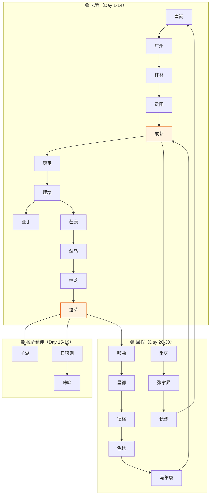
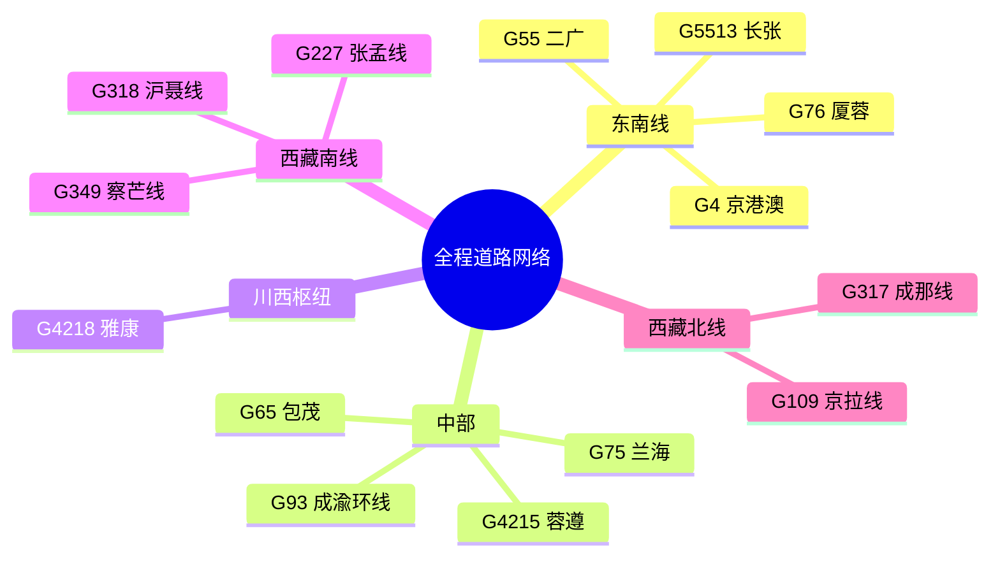

# 🛣️ 路线与道路编号

本文档详细解析全程涉及的所有道路编号、命名规则、沿途连接城市。

---

## 🗺️ 总体路网拓扑



---

## 🛣️ 国家高速（9条）

### <span class="road-badge road-badge-g4">G4</span> 京港澳高速

| 项目 | 内容 |
|------|------|
| **全称** | 北京-香港-澳门高速 |
| **总长** | 2,285 km |
| **本程路段** | 皇岗 → 广州 → 长沙 → 皇岗 |
| **里程** | ~1,250 km |
| **限速** | 100-120 km/h |
| **充电** | <span class="charge-badge charge-5c">理想5C密集</span> <span class="charge-badge charge-fast">国网250kW</span> |

**途经城市/出口**：

```
皇岗 → 深圳市区 → 东莞 → 广州（北二环）→ 韶关 → 郴州
→ 衡阳 → 长沙 → 岳阳 → 咸宁 → 武汉（途中不进入）
→ ... → 香港
```

**关键服务区充电站**：

- 🟢 **东莞厚街服务区**（理想5C）
- 🟢 **广州北二环高速服务区**（理想5C）
- 🟢 **曲江服务区**（理想5C）
- 🟢 **郴州服务区**（理想5C）
- 🟢 **衡阳服务区**（理想5C）

---

### <span class="road-badge road-badge-g55">G55</span> 二广高速

| 项目 | 内容 |
|------|------|
| **全称** | 二连浩特-广州高速 |
| **总长** | 2,685 km |
| **本程路段** | 清远 → 贺州 → 桂林 |
| **里程** | ~480 km |
| **充电** | <span class="charge-badge charge-fast">国网桩</span> <span class="charge-badge charge-normal">公共桩</span> |

**途经**：

```
清远 → 连州 → 贺州（黄姚古镇）→ 钟山 → 平乐 → 桂林
```

**服务区充电**：

- 🟢 **水口南服务区**（理想5C，广龙高速）
- 🟢 **凤凰服务区**
- 🟢 **八角寨服务区**

---

### <span class="road-badge road-badge-g76">G76</span> 厦蓉高速

| 项目 | 内容 |
|------|------|
| **全称** | 厦门-成都高速 |
| **总长** | 2,210 km |
| **本程路段** | 桂林 → 贵阳 |
| **里程** | ~560 km |
| **充电** | <span class="charge-badge charge-fast">国网桩密集</span> |

**途经**：

```
桂林 → 三江（侗族）→ 榕江 → 都匀 → 贵阳东
```

---

### <span class="road-badge road-badge-g75">G75</span> 兰海高速

| 项目 | 内容 |
|------|------|
| **全称** | 兰州-海口高速 |
| **总长** | 2,580 km |
| **本程路段** | 贵阳 → 遵义 → 重庆 |
| **里程** | ~360 km |
| **充电** | <span class="charge-badge charge-5c">理想5C部分</span> <span class="charge-badge charge-fast">国网桩</span> |

**途经**：

```
贵阳 → 息烽 → 遵义（会议会址）→ 桐梓 → 重庆
```

---

### <span class="road-badge road-badge-g4215">G4215</span> 蓉遵高速

| 项目 | 内容 |
|------|------|
| **全称** | 成都-遵义高速 |
| **总长** | 540 km |
| **本程路段** | 仁怀 → 泸州 → 成都 |
| **里程** | ~480 km |
| **充电** | <span class="charge-badge charge-fast">公共桩</span> |

**途经**：

```
遵义 → 仁怀（茅台镇）→ 古蔺 → 叙永 → 泸州 → 隆昌 → 成都
```

---

### <span class="road-badge road-badge-g4218">G4218</span> 雅康高速

| 项目 | 内容 |
|------|------|
| **全称** | 雅安-康定高速 |
| **总长** | 135 km |
| **本程路段** | 雅安 → 康定 |
| **里程** | ~135 km（去程实际 320km 含其他路段）|
| **特殊** | **川藏第一桥**（泸定大渡河大桥）、**二郎山隧道** |
| **充电** | <span class="charge-badge charge-5c">理想5C</span> |

**途经**：

```
雅安 → 草坝 → 新沟 → 二郎山隧道 → 泸定 → 雅康跨大渡河大桥
→ 跑马山 → 康定
```

**关键节点**：

- 🟢 **雅安蒙山府站**（理想5C，进藏第一充）
- 泸定大渡河大桥（钢混叠合梁特大桥，亚洲第二）

---

### <span class="road-badge road-badge-g93">G93</span> 成渝环线高速

| 项目 | 内容 |
|------|------|
| **全称** | 成都-重庆环线高速 |
| **总长** | 1,058 km（环线）|
| **本程路段** | 成都 ⇄ 重庆 |
| **里程** | ~340 km（直走） |
| **充电** | <span class="charge-badge charge-5c">理想5C密集</span>（135座）|

**途经**：

```
成都（成渝高速入口）→ 龙泉 → 资阳 → 内江 → 永川 → 重庆
```

**关键充电**：

- 🟢 **简阳服务区**（理想5C）
- 🟢 **资阳服务区**（理想5C）
- 🟢 **内江服务区**（理想5C）
- 🟢 **永川服务区**（理想5C）

---

### <span class="road-badge road-badge-g65">G65</span> 包茂高速

| 项目 | 内容 |
|------|------|
| **全称** | 包头-茂名高速 |
| **总长** | 3,022 km |
| **本程路段** | 重庆 → 武隆 → 湘西 → 张家界 |
| **里程** | ~520 km |
| **充电** | <span class="charge-badge charge-5c">理想5C部分</span> |

**途经**：

```
重庆 → 南川 → 武隆（天生三桥）→ 彭水 → 黔江 → 酉阳
→ 秀山 → 凤凰 → 吉首 → 张家界
```

**关键服务区**：

- 🟢 **G65大巴山服务区**（理想5C，G69银百高速共用）
- 🟢 **武隆服务区**（理想5C）

---

### <span class="road-badge road-badge-g5513">G5513</span> 长张高速

| 项目 | 内容 |
|------|------|
| **全称** | 长沙-张家界高速 |
| **总长** | 320 km |
| **本程路段** | 长沙 → 张家界 |
| **里程** | ~320 km（直走 350km 含绕道） |
| **充电** | <span class="charge-badge charge-fast">公共桩</span> |

**途经**：

```
长沙（岳麓区）→ 益阳 → 常德 → 慈利 → 张家界（永定区）
```

---

## 🏞️ 国家国道（5条）

### <span class="road-badge road-badge-g318">G318</span> 沪聂线

| 项目 | 内容 |
|------|------|
| **全称** | 上海-聂拉木（西藏）国道 |
| **总长** | 5,476 km（**中国最长国道**）|
| **本程路段** | 成都 → 康定 → 理塘 → 芒康 → 然乌 → 林芝 → 拉萨 |
| **里程** | ~2,150 km |
| **特色** | 🟢 **去程主线** · 中国最美景观大道 |
| **充电** | <span class="charge-badge charge-5c">理想5C全线</span> |

**分段详解**：

```
成都（0）→ 雅安（150）→ 康定（320）→ 新都桥（370）→ 雅江（470）
→ 理塘（660）→ 巴塘（870）→ 芒康（1050）→ 左贡（1180）→ 邦达（1280）
→ 八宿（1360）→ 然乌（1480）→ 波密（1650）→ 通麦（1750）→ 鲁朗（1830）
→ 林芝（1950）→ 工布江达（2080）→ 墨竹工卡（2210）→ 拉萨（2360）
```

**关键垭口**：

| 垭口 | 海拔 | 位置 |
|------|------|------|
| 折多山 | 4298m | 康定-新都桥 |
| 高尔寺山 | 4412m | 新都桥-雅江 |
| 剪子弯山 | 4659m | 雅江-理塘 |
| 卡子拉山 | 4718m | 雅江-理塘 |
| 拉乌山 | 4338m | 芒康-左贡 |
| 东达山 | 5130m | 左贡-邦达 |
| 业拉山 | 4658m | 邦达-八宿 |
| 安久拉山 | 4325m | 八宿-然乌 |
| 色季拉山 | 4702m | 林芝-鲁朗 |
| 米拉山 | 5013m | 林芝-拉萨 |

**理想5C站点**（沿线12座）：

1. 🟢 雅安蒙山府站
2. 🟢 康定新都桥可往酒店站
3. 🟢 甘孜理塘虫草大酒店站
4. 🟢 甘孜巴塘弦韵酒店站
5. 🟢 芒康如美温泉大酒店站
6. 🟢 左贡悦溪度假酒店站
7. 🟢 八宿然乌湖站
8. 🟢 波密格拉丹东酒店站
9. 🟢 林芝鲁朗珠江国际酒店站（1×5C + 7×2C）
10. 🟢 工布江达服务区站
11. 🟢 甘丹寺服务区站
12. 🟢 拉萨城区站

---

### <span class="road-badge road-badge-g317">G317</span> 成那线

| 项目 | 内容 |
|------|------|
| **全称** | 成都-那曲（西藏）国道 |
| **总长** | 2,030 km |
| **本程路段** | 成都 → 马尔康 → 色达 → 德格 → 昌都 → 那曲 |
| **里程** | ~2,400 km |
| **特色** | 🟣 **回程主线** · 川藏北线 · 更原始 |
| **充电** | <span class="charge-badge charge-fast">国网桩</span> <span class="charge-badge charge-normal">第三方</span> |

**分段详解**：

```
成都（0）→ 都江堰（80）→ 汶川（160）→ 理县（260）→ 米亚罗（290）
→ 马尔康（420）→ 壤塘（550）→ 炉霍（700）→ 甘孜（850）→ 德格（1100）
→ 江达（1250）→ 昌都（1430）→ 类乌齐（1580）→ 丁青（1680）→ 巴青（1850）
→ 索县（1950）→ 那曲（2080）→ 拉萨（2400）
```

**关键垭口**：

| 垭口 | 海拔 | 位置 |
|------|------|------|
| 鹧鸪山 | 4120m | 汶川-理县 |
| 梦笔山 | 4114m | 马尔康-壤塘 |
| 雅克夏雪山 | 4420m | 壤塘-炉霍 |
| 卡萨湖 | 3510m | 炉霍-甘孜 |
| 雀儿山 | **5050m** | 德格-马尼干戈 |
| 矮拉山 | 4245m | 江达-昌都 |
| 珠角拉山 | 4688m | 类乌齐-丁青 |

**主要充电站**：

| 站点 | 桩型 | 功率 | 备注 |
|------|------|------|------|
| 那曲 | 国网 | 120kW | |
| 丁青 | 第三方 | 120kW | |
| 昌都 | 国网 | 120-250kW | 补给充足 |
| 德格 | 第三方 | 120kW | ⚠️ 仅3站6枪 |
| 甘孜县 | 国网 | 120kW | 10站30枪 |
| 色达 | 第三方 | 120kW | 9站27枪 |
| 马尔康高速路口 | **国网** | **600kW** | 🌟 **北线最强站** |
| 理县服务区 | **理想5C** | **520kW + 250kW** | 🌟 **返回成都惊喜** |

---

### <span class="road-badge road-badge-g227">G227</span> 张孟线

| 项目 | 内容 |
|------|------|
| **全称** | 张掖-孟连（云南）国道 |
| **总长** | 3,345 km |
| **本程路段** | 理塘 → 稻城 → 香格里拉镇 |
| **里程** | ~280 km |
| **特色** | 通往"蓝色星球最后一片净土" |

**分段**：

```
理塘（4014m）→ 奔戈乡 → 措拉乡 → 桑堆 → 稻城（3750m）→ 日瓦（香格里拉镇，2900m）→ 亚丁村（3700m）→ 冲古寺 → 洛绒牛场
```

---

### <span class="road-badge road-badge-g109">G109</span> 京拉线

| 项目 | 内容 |
|------|------|
| **全称** | 北京-拉萨国道（青藏线）|
| **总长** | 3,901 km |
| **本程路段** | 拉萨 → 当雄 → 那曲 |
| **里程** | ~320 km |
| **特色** | 🟣 连接 G317 起点 · 青藏铁路伴行 |

**途经**：

```
拉萨 → 羊八井 → 当雄 → 纳木措（绕道）→ 那曲
```

---

### <span class="road-badge road-badge-g349">G349</span> 察芒线

| 项目 | 内容 |
|------|------|
| **全称** | 察雅-芒康（规划延伸至拉萨-亚东）|
| **本程路段** | 拉萨 → 岗巴拉 → 羊湖 → 江孜 → 日喀则 |
| **里程** | ~350 km |
| **特色** | 🟢 羊卓雍措观景大道 |

**途经**：

```
拉萨 → 曲水 → 岗巴拉山口（4990m）→ 羊卓雍措 → 浪卡子 → 江孜
→ 白居寺 → 日喀则
```

---

## 📊 道路编号速查

### 按里程排序

| 排名 | 编号 | 名称 | 本程里程 | 类型 |
|------|------|------|----------|------|
| 1 | <span class="road-badge road-badge-g317">G317</span> | 成那线 | 2,400 km | 国道 |
| 2 | <span class="road-badge road-badge-g318">G318</span> | 沪聂线 | 2,150 km | 国道 |
| 3 | <span class="road-badge road-badge-g4">G4</span> | 京港澳 | 1,250 km | 高速 |
| 4 | <span class="road-badge road-badge-g76">G76</span> | 厦蓉 | 560 km | 高速 |
| 5 | <span class="road-badge road-badge-g65">G65</span> | 包茂 | 520 km | 高速 |
| 6 | <span class="road-badge road-badge-g55">G55</span> | 二广 | 480 km | 高速 |
| 7 | <span class="road-badge road-badge-g4215">G4215</span> | 蓉遵 | 480 km | 高速 |
| 8 | <span class="road-badge road-badge-g109">G109</span> | 京拉线 | 450 km | 国道 |
| 9 | <span class="road-badge road-badge-g75">G75</span> | 兰海 | 360 km | 高速 |
| 10 | <span class="road-badge road-badge-g5513">G5513</span> | 长张 | 350 km | 高速 |
| 11 | <span class="road-badge road-badge-g93">G93</span> | 成渝环线 | 340 km | 高速 |
| 12 | <span class="road-badge road-badge-g4218">G4218</span> | 雅康 | 135 km | 高速 |
| 13 | <span class="road-badge road-badge-g227">G227</span> | 张孟线 | 280 km | 国道 |
| 14 | <span class="road-badge road-badge-g349">G349</span> | 察芒线 | 220 km | 国道 |

### 按地理位置



---

## 🎯 关键道路对比

### G318 vs G317

| 维度 | 🟢 G318（去程） | 🟣 G317（回程） |
|------|----------------|----------------|
| 起点 | 成都 | 拉萨 |
| 终点 | 拉萨 | 成都 |
| 总里程 | 2,150 km | 2,400 km |
| 海拔均值 | 较高 | 极高 |
| 最高点 | 东达山 5130m | 雀儿山 5050m |
| 充电 | 🟢 理想5C密集 | 🟡 国网桩为主 |
| 风景 | 秀丽湖泊、雪山 | 草原、寺庙、原始 |
| 难度 | ⭐⭐⭐ | ⭐⭐⭐⭐ |
| 适宜人群 | 首次进藏 | 二次进藏 |
| 著名点 | 然乌湖、南迦巴瓦 | 色达、新路海 |

---

## ⏭️ 下一步

- ⚡ 查看 [充电站网络](charging.md) 了解补能规划
- 🏔️ 查看 [高反与健康](health.md) 了解高原注意事项
- 📍 查看 [第二阶段·G318](stage-2-g318.md) 和 [第四阶段·G317](stage-4-g317.md)
