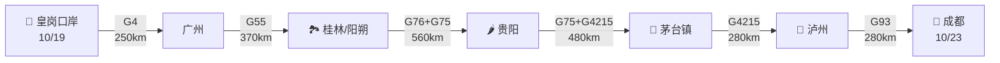

# 🟢 第一阶段·南行入川（Day 1-5）

**核心目标**：从皇岗口岸出发，经桂林、贵阳、泸州到达成都，节奏轻松，享受沿途风光。

---

## 📊 阶段总览

<div class="stat-bar">
<div class="stat-item">
<div class="stat-value">5</div>
<div class="stat-label">天数</div>
</div>
<div class="stat-item">
<div class="stat-value">1,940</div>
<div class="stat-label">公里</div>
</div>
<div class="stat-item">
<div class="stat-value">388</div>
<div class="stat-label">日均公里</div>
</div>
<div class="stat-item">
<div class="stat-value">500m</div>
<div class="stat-label">海拔（终点成都）</div>
</div>
</div>

---

## 🗺️ 路线图



---

## 📅 每日行程

<div class="day-card">

### Day 1（10/19 周一）皇岗 → 贺州 → 桂林

**路线**：皇岗 → <span class="road-badge road-badge-g4">G4</span>京港澳 → 广州北二环 → <span class="road-badge road-badge-g55">G55</span>二广 → 贺州 → 桂林

**里程**：约 620 km | **用时**：约 7.5 小时

**充电安排**：

| 站点 | 桩型 | 时长 |
|------|------|------|
| 东莞厚街服务区 | <span class="charge-badge charge-5c">理想5C</span> | 15分钟 |
| 广州北二环服务区 | <span class="charge-badge charge-5c">理想5C</span> | 15分钟 |
| 水口南服务区 | <span class="charge-badge charge-5c">理想5C</span> | 20分钟 |
| 桂林两江服务区 | <span class="charge-badge charge-fast">国网250kW</span> | 30分钟 |

**沿途景点**：

- 🏞️ **贺州黄姚古镇**（岭南古镇，千年历史，门票 88元）
  - 推荐游玩 2 小时
  - 必看：古榕树、龙爪榕、带龙桥

**桂林住宿推荐**：

- 香格里拉大酒店（两江四湖景区，580元/晚）
- 桂林喜来登饭店（700元/晚，5星）
- 桂林宾馆（300元/晚，性价比高）

**今日美食**：

- 🍜 **桂林米粉**（崇善米粉、老东江米粉）
- 🥘 啤酒鱼（阳朔必吃）
- 🍚 荔浦芋扣肉

</div>

<div class="day-card">

### Day 2（10/20 周二）桂林深度游

**今日主题**：桂林山水甲天下

**行程**：

```
07:00 酒店早餐
08:30 象鼻山公园（1.5小时）🌟 桂林城徽
10:30 漓江竹筏（杨堤-九马画山段，约 4 小时）🌟
15:00 午餐（啤酒鱼）
16:00 阳朔西街闲逛
19:00 晚餐（西街美食）
20:00 《印象·刘三姐》实景演出（可选）
```

**充电**：阳朔酒店充（白天使用，晚上充电）

**住宿**：阳朔西街附近

- 阳朔糖舍酒店（顶级设计酒店，1200元/晚）🌟
- 阳朔西街口酒店（300元/晚）
- 阳朔万丽酒店（500元/晚）

**今日美食**：

- 啤酒鱼（谢大姐、彭大姐）
- 阳朔田螺
- 桂林油茶

!!! tip "📍 漓江竹筏小贴士"
    - 提前 1 天在官方平台预订
    - 杨堤-兴坪段最经典（含 20元背景）
    - 建议 8:30 出发，避开人潮

</div>

<div class="day-card">

### Day 3（10/21 周三）阳朔 → 荔波小七孔 → 贵阳

**路线**：阳朔 → <span class="road-badge road-badge-g76">G76</span>厦蓉 → 麻尾 → **荔波小七孔**（绕道 50km） → 都匀 → 贵阳

**里程**：约 700 km（去程含绕道） | **用时**：约 9 小时

**充电安排**：

| 站点 | 桩型 | 时长 |
|------|------|------|
| 桂林西服务区 | <span class="charge-badge charge-fast">国网120kW</span> | 30分钟 |
| 都匀东服务区 | <span class="charge-badge charge-fast">国网250kW</span> | 25分钟 |
| 贵阳城区 | <span class="charge-badge charge-5c">理想5C</span> | 15分钟 |

**沿途景点** 🌟 强烈推荐：

**荔波小七孔**（"地球绿宝石"）

- 门票：120元 + 观光车 40元
- 游玩时间：3-4 小时
- 必看：小七孔古桥、68级跌水瀑布、拉雅瀑布、水上森林
- 距贵阳约 240 km

**贵阳住宿推荐**：

- 贵阳亨特索菲特酒店（500元/晚，地标）
- 贵阳万丽酒店（600元/晚）
- 贵阳凯宾斯基（700元/晚）

**今日美食**：

- 🍜 **肠旺面**（贵阳特色）
- 🥘 **酸汤鱼**（苗族特色）
- 🍢 **丝娃娃**（贵阳小吃）

!!! tip "💡 行程取舍"
    如果不去荔波，可缩短至 560 km：
    阳朔 → G76 → 都匀 → 贵阳，下午 4 点即可抵达贵阳

</div>

<div class="day-card">

### Day 4（10/22 周四）贵阳 → 遵义会议会址 → 茅台镇 → 泸州

**路线**：贵阳 → <span class="road-badge road-badge-g75">G75</span>兰海 → 遵义 → **茅台镇**（绕道 30km）→ 仁怀 → <span class="road-badge road-badge-g4215">G4215</span>蓉遵 → 泸州

**里程**：约 480 km | **用时**：约 6.5 小时

**充电安排**：

| 站点 | 桩型 | 时长 |
|------|------|------|
| 息烽服务区 | <span class="charge-badge charge-fast">国网250kW</span> | 25分钟 |
| 茅台镇服务区 | <span class="charge-badge charge-fast">国网120kW</span> | 30分钟 |
| G69 大巴山服务区 | <span class="charge-badge charge-5c">理想5C</span> | 15分钟 |
| 泸州城区 | <span class="charge-badge charge-fast">国网</span> | 30分钟 |

**沿途景点**：

**遵义会议会址** 🌟（红色圣地）

- 门票：免费（需预约）
- 游玩时间：2-3 小时
- 必看：会议室、红军总政治部旧址

**茅台镇**（中国酒都）

- 门票：免费（部分景点收费）
- 游玩时间：2-3 小时
- 必看：茅台酒厂大门、赤水河谷、1915 广场
- 推荐：茅台镇夜景、赤水河夜景

**泸州住宿推荐**：

- 泸州酒城宾馆（300元/晚，泸州老窖旗下）
- 泸州巨洋国际酒店（400元/晚）
- 泸州万达广场附近酒店（300元/晚）

**今日美食**：

- 🍶 **茅台镇品酒**（必须尝！）
- 🥘 遵义豆花面
- 🌶️ 泸州黄粑

!!! warning "⚠️ 茅台镇购酒提醒"
    镇内酒商鱼龙混杂，**不要轻信"内部价"**，建议：
    - 在茅台酒文化城官方店购买
    - 在中国酒文化城官方旗舰店购买
    - 不买"年份酒""纪念酒"，多为勾兑

</div>

<div class="day-card">

### Day 5（10/23 周五）泸州 → 成都（整备日）

**路线**：泸州 → <span class="road-badge road-badge-g4215">G4215</span>蓉遵 → 隆昌 → <span class="road-badge road-badge-g93">G93</span>成渝环线 → 成都

**里程**：约 280 km | **用时**：约 3.5 小时

**今日目标**：抵达成都，开始**整备日**

**充电**：

- 🟢 **简阳服务区**（理想5C，5分钟充至 80%）
- 🟢 **成都高新/郫都理想超充**（5C）

**整备清单**：

- ✅ **车辆保养**：理想售后服务中心（提前预约）
  - 机油机滤
  - 电池组检查
  - 轮胎气压
  - 刹车系统
- ✅ **边防证办理**：成都公安局出入境（高新南区）
- ✅ **采购物资**：
  - 氧气袋 2 个
  - 红景天（备用）
  - 高能食品
  - 保暖衣物（如有缺）
- ✅ **现金补充**：ATM 取现

**下午：成都半日游**

- 🏛️ **宽窄巷子**（清代古街，免费）
- 🎭 **锦里古街**（三国主题，免费）
- 🐼 **成都大熊猫繁育研究基地**（门票 55元，可选）
- 🍵 人民公园鹤鸣茶社（喝茶发呆）

**晚上：成都美食**

- 🍲 成都火锅（**蜀九香、肖四民、小龙坎**）
- 🥘 串串香（**玉林串串、钢管厂五区**）
- 🍢 兔头（**双流老妈兔头**）

**成都住宿推荐**：

- 成都瑞吉酒店（1200元/晚，顶级）
- 成都钓鱼台精品酒店（800元/晚）
- 成都群光君悦酒店（500元/晚）
- 锦江宾馆（400元/晚，老牌）

!!! tip "💡 整备日建议"
    上午办理边防证（高新南区），下午保养车辆，傍晚逛宽窄巷子。时间紧凑但可行。

</div>

---

## 🎯 阶段关键节点

### 重要充电点

| 充电站 | 桩型 | 用途 |
|--------|------|------|
| 东莞厚街服务区 | <span class="charge-badge charge-5c">理想5C</span> | 出发第一充 |
| 广州北二环 | <span class="charge-badge charge-5c">理想5C</span> | 粤北段 |
| G69大巴山服务区 | <span class="charge-badge charge-5c">理想5C</span> | 进川前最后5C |
| 简阳服务区 | <span class="charge-badge charge-5c">理想5C</span> | 抵成都前 |

### 关键检查站

- **皇岗口岸**：24小时通关，需"i口岸"预约
- **湘桂省界**：偶尔抽检身份证
- **贵川省界**：基本免检
- **川南**：基本免检

---

## ⏭️ 下一步

- 🟢 进入 [第二阶段·G318川藏南线](stage-2-g318.md)
- ⚡ 查看 [充电站网络](charging.md)
- 🏔️ 查看 [高反与健康](health.md)
