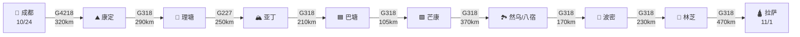

# 🔵 第二阶段·G318川藏南线（Day 6-14）

**核心目标**：穿越 G318 川藏南线，从成都经康定、理塘、稻城亚丁、芒康、然乌、林芝抵达拉萨。本阶段是全程最壮美的部分，9 天时间从容走完。

---

## 📊 阶段总览

<div class="stat-bar">
<div class="stat-item">
<div class="stat-value">9</div>
<div class="stat-label">天数</div>
</div>
<div class="stat-item">
<div class="stat-value">2,150</div>
<div class="stat-label">公里</div>
</div>
<div class="stat-item">
<div class="stat-value">500+</div>
<div class="stat-label">最高海拔(东达山)</div>
</div>
<div class="stat-item">
<div class="stat-value">12</div>
<div class="stat-label">理想5C站点</div>
</div>
</div>

---

## 🗺️ 路线图



---

## 🛣️ G318 核心道路解读

### G318 川藏南线

**总长**：5,476 km（中国最长国道）
**本程里程**：约 2,150 km
**特色**：🟢 中国的"景观大道"，全程海拔爬升近 4,000m

**关键垭口**：

| 垭口 | 海拔 | 本日里程 | 难度 |
|------|------|----------|------|
| 折多山 | <span class="altitude altitude-high">4298m</span> | Day 6 | ⭐⭐ |
| 高尔寺山 | <span class="altitude altitude-high">4412m</span> | Day 7 | ⭐⭐ |
| 剪子弯山 | <span class="altitude altitude-high">4659m</span> | Day 7 | ⭐⭐⭐ |
| 卡子拉山 | <span class="altitude altitude-high">4718m</span> | Day 7 | ⭐⭐ |
| 拉乌山 | <span class="altitude altitude-high">4338m</span> | Day 11 | ⭐⭐ |
| 东达山 | <span class="altitude altitude-extreme">5130m</span> | Day 11 | ⭐⭐⭐⭐ |
| 业拉山 | <span class="altitude altitude-high">4658m</span> | Day 11 | ⭐⭐⭐ |
| 安久拉山 | <span class="altitude altitude-high">4325m</span> | Day 12 | ⭐⭐ |
| 色季拉山 | <span class="altitude altitude-high">4702m</span> | Day 13 | ⭐⭐⭐ |
| 米拉山 | <span class="altitude altitude-extreme">5013m</span> | Day 14 | ⭐⭐⭐ |

---

## 📅 每日行程

<div class="day-card">

### Day 6（10/24 周六）成都 → 雅安 → 泸定 → 康定

**路线**：成都 → <span class="road-badge road-badge-g4218">G4218</span>雅康高速 → 雅安 → 二郎山隧道 → 泸定桥 → 康定

**里程**：约 320 km | **用时**：约 5 小时

**充电安排**：

| 站点 | 桩型 | 用途 |
|------|------|------|
| 🟢 **雅安蒙山府站** | <span class="charge-badge charge-5c">理想5C</span> | 进藏第一充 |
| 🟢 **康定城区站** | <span class="charge-badge charge-5c">理想5C</span> | 过夜充满 |

**沿途景点**：

**雅安碧峰峡**（大熊猫基地，可选）

- 门票：180元（含观光车）
- 游玩时间：3-4 小时

**泸定桥** 🌟（强渡大渡河）

- 门票：10元
- 游玩时间：30-60分钟
- 历史：1935 年红军 22 勇士强渡大渡河

**折多山垭口** 🌟

- 海拔 4298m，进藏第一道关
- 游玩时间：30 分钟
- 必拍：经幡、雪山

**康定住宿推荐**：

- 康定情歌酒店（400元/晚）
- 康定格萨尔酒店（300元/晚，藏式）
- 康定溜溜城酒店（500元/晚）

**今日美食**：

- 🥘 康定凉粉
- 🍵 酥油茶
- 🍖 牦牛肉

!!! warning "⚠️ 海拔适应"
    康定海拔 2560m，**第一次到达高海拔**。建议：
    - 慢走，勿剧烈运动
    - 多喝温水
    - 当晚不洗澡
    - 监测血氧

</div>

<div class="day-card">

### Day 7（10/25 周日）康定 → 新都桥 → 雅江 → 理塘

**路线**：<span class="road-badge road-badge-g318">G318</span> → 折多山（4298m）→ 新都桥 → 高尔寺山隧道（4412m）→ 雅江 → 剪子弯山（4659m）→ 卡子拉山（4718m）→ 理塘

**里程**：约 290 km | **用时**：约 6 小时

**充电安排**：

| 站点 | 桩型 | 用途 |
|------|------|------|
| 🟢 **新都桥可往酒店站** | <span class="charge-badge charge-5c">理想5C</span> | 上午补电 |
| 🟢 **理塘虫草大酒店站** | <span class="charge-badge charge-5c">理想5C</span> | 抵达满充 |

**沿途景点**：

**新都桥十里画廊** 🌟🌟🌟

- 10 月秋色最美（金黄杨林）
- 免费
- 游玩时间：2-3 小时
- 摄影点：瓦泽乡、营官村

**卡子拉山**

- 海拔 4718m
- 游玩时间：20 分钟

**理塘千户藏寨**

- 必看：丁真工作的博物馆
- 海拔 4014m，**世界高城**

**理塘住宿推荐**：

- 理塘仓央嘉措微型博物馆酒店（400元/晚）
- 理塘虫草大酒店（500元/晚，**附 5C 超充站**）
- 理塘香格里拉酒店（300元/晚）

!!! danger "⚠️ 重要提示：理塘高反"
    理塘海拔 **4014m**，是全程住宿海拔最高的城市之一。当晚务必：
    1. 监测血氧（建议 > 80%）
    2. 服用红景天
    3. 多喝温水
    4. **不要洗澡**
    5. 早休息
    6. 出现严重不适立即下撤至新都桥（3450m）

</div>

<div class="day-card">

### Day 8（10/26 周一）理塘 → 稻城亚丁（亚丁短线）

**路线**：<span class="road-badge road-badge-g318">G318</span>理塘 → <span class="road-badge road-badge-g227">G227</span> → 稻城 → 香格里拉镇 → 亚丁景区

**里程**：约 250 km | **用时**：约 4 小时

**充电**：

- 稻城明宇丽雅阳光温泉酒店（蔚来 120kW）

**今日主攻：稻城亚丁短线**（高反友好）

**亚丁景区**：

- 门票：266元（含观光车）
- 短线：冲古寺 → 珍珠海（约 4-5 小时）
- 海拔：2900-4100m

**亚丁短线行程**：

```
08:00 酒店早餐
09:00 亚丁景区门口
09:30 乘坐观光车（1 小时）
10:30 扎灌崩 → 冲古寺
11:30 珍珠海（仙乃日神山倒影）🌟
13:00 返回冲古寺，午餐
14:00 冲古草甸
16:00 返程
17:30 香格里拉镇酒店
```

**香格里拉镇住宿**（海拔 2900m）：

- 香格里拉镇亚丁天堂酒店（400元/晚）
- 日瓦松茸家园酒店（300元/晚）
- 亚丁村藏式客栈（200元/晚，看星空）

!!! tip "💡 长短线选择"
    - **短线**（Day 8）：珍珠海，体力消耗小
    - **长线**（Day 9）：牛奶海+五色海，体力消耗大
    - 建议：第一天短线适应，第二天长线深度

</div>

<div class="day-card">

### Day 9（10/27 周二）稻城亚丁长线（牛奶海+五色海）

**今日主攻：稻城亚丁长线**（必看！）

**亚丁长线行程**：

```
06:00 早起，酒店早餐
07:00 抵达景区门口（避开人潮）
07:30 观光车到扎灌崩
08:00 冲古寺 → 洛绒牛场（电瓶车 80元，约 30 分钟）
09:30 洛绒牛场 → 牛奶海（徒步或骑马，骑马 305元/单程）
11:30 抵达 **牛奶海** 🌟🌟🌟（海拔 4600m）
12:30 徒步至 **五色海** 🌟🌟（海拔 4700m）
13:30 返程
16:00 抵达扎灌崩
17:00 返酒店
```

**亚丁长线必看**：

- **三神山**（央迈勇、仙乃日、夏诺多吉）—— 藏传佛教三怙主
- **牛奶海** —— 雪山环抱中的蓝色高山湖泊
- **五色海** —— 因光线折射呈现多色
- **洛绒牛场** —— 草甸、溪流、雪山
- **冲古寺** —— 藏传佛教寺庙

!!! danger "⚠️ 亚丁长线高反风险"
    - 牛奶海 4600m，五色海 4700m，**最高点接近高反警戒线**
    - 徒步 6-8 小时，体力消耗大
    - 建议：前几天充分休息，当日多喝水
    - 不适立即下撤

**亚丁美食**：

- 🍖 牦牛肉火锅
- 🥛 酥油茶
- 🍞 糌粑

</div>

<div class="day-card">

### Day 10（10/28 周三）稻城 → 理塘 → 巴塘 → 芒康

**路线**：原路返理塘 → <span class="road-badge road-badge-g318">G318</span> → 措拉 → 巴塘 → **金沙江大桥**（川藏界）→ 芒康

**里程**：约 380 km | **用时**：约 7 小时

**充电安排**：

| 站点 | 桩型 | 用途 |
|------|------|------|
| 🟢 **理塘虫草大酒店站** | <span class="charge-badge charge-5c">理想5C</span> | 上午补电 |
| 🟢 **巴塘弦韵酒店站** | <span class="charge-badge charge-5c">理想5C</span> | 下午补电 |
| 🟢 **芒康如美温泉大酒店站** | <span class="charge-badge charge-5c">理想5C</span> | 过夜满充 |

**沿途景点**：

- 金沙江峡谷（川藏分界）
- 澜沧江峡谷
- **金沙江大桥**（川/藏界）

!!! warning "⚠️ 金沙江大桥检查站"
    - 必查身份证
    - 必查**边防证**（如去珠峰方向）
    - 高速 30km/h 通过

**芒康住宿**（海拔 3875m）：

- 芒康如美温泉大酒店（500元/晚，**附 5C 超充站**）
- 芒康大酒店（300元/晚）
- 芒康藏式酒店（200元/晚）

**今日美食**：

- 🍖 芒康牦牛肉
- 🍵 藏式甜茶
- 🥔 糌粑

</div>

<div class="day-card">

### Day 11（10/29 周四）芒康 → 左贡 → 邦达 → 八宿

**路线**：<span class="road-badge road-badge-g318">G318</span> → 拉乌山（4338m）→ 如美 → **东达山（5130m）** → 左贡 → 邦达 → **业拉山（4658m，72道拐）** → 八宿

**里程**：约 370 km | **用时**：约 7 小时

**充电安排**：

| 站点 | 桩型 | 用途 |
|------|------|------|
| 🟢 **左贡悦溪度假酒店站** | <span class="charge-badge charge-5c">理想5C</span> | 午餐补电 |
| 🟢 **八宿然乌湖站** | <span class="charge-badge charge-5c">理想5C</span> | 过夜满充 |

**沿途景点**：

**东达山** 🌟（海拔 5130m）

- G318 最高点
- 游玩时间：20 分钟
- 注意：风大、可能下雪

**业拉山 + 72 道拐** 🌟🌟

- 72 道拐：G318 最险路段
- 连续下坡 30+ km
- 必拍：垭口俯瞰全貌
- **注意刹车温度！** 长下坡低速挡配合点刹

**怒江大峡谷**（业拉山下）

- 谷深 2000+ 米
- 险峻壮观

**八宿 / 然乌湖住宿**（海拔 3280m）：

- 八宿然乌湖站理想5C超充附近酒店（400元/晚）
- 然乌湖景观酒店（500元/晚，看湖）
- 八宿温泉酒店（300元/晚）

!!! danger "⚠️ 72道拐驾驶技巧"
    - **低速挡**为主，D 档 + S 档交替
    - **点刹**：每 5-10 秒点刹一次
    - 不可长时间踩死刹车（**刹车过热失灵**）
    - 关注仪表盘刹车温度
    - 抵达八宿后**检查刹车片**

</div>

<div class="day-card">

### Day 12（10/30 周五）八宿 → 然乌湖 → 米堆冰川 → 波密

**路线**：<span class="road-badge road-badge-g318">G318</span> → 然乌湖（晨曦）→ 米堆冰川（绕道 8km）→ 波密

**里程**：约 170 km | **用时**：约 3 小时

**充电**：

- 🟢 **波密格拉丹东酒店站**（理想5C）

**沿途景点**：

**然乌湖晨曦** 🌟🌟🌟（必看！）

- 早起 6:30 看晨雾
- 湖水倒映雪山
- 免费
- 游玩时间：1-2 小时

**米堆冰川** 🌟🌟

- 门票：50元 + 观光车 36元
- 中国最美冰川之一
- 可近距离接触冰川舌
- 游玩时间：2-3 小时

**波密住宿**（海拔 2750m）：

- 波密格拉丹东酒店（500元/晚，**附 5C 超充站**）
- 波密海螺酒店（300元/晚）
- 波密藏式客栈（200元/晚）

**今日特色**：

- 🌲 **波密森林**：中国最美森林之一
- 🍎 波密苹果、藏香猪

</div>

<div class="day-card">

### Day 13（10/31 周六）波密 → 通麦 → 鲁朗 → 林芝

**路线**：<span class="road-badge road-badge-g318">G318</span> → 通麦天险（隧道已通）→ 鲁朗 → **色季拉山（4702m）** → 林芝

**里程**：约 230 km | **用时**：约 5 小时

**充电**：

- 🟢 **林芝鲁朗珠江国际酒店站**（理想5C，1×5C + 7×2C）

**沿途景点**：

**通麦天险**（已变通途）

- 原 14km 险路，2016 年隧道+大桥贯通
- 现仅需 30 分钟
- 历史照片对比

**鲁朗林海** 🌟

- 免费
- 游玩时间：1-2 小时
- "西藏江南"代表

**色季拉山** 🌟🌟

- 海拔 4702m
- **远眺南迦巴瓦峰（7782m）** —— 中国最美山峰
- 必拍！

**林芝住宿**（海拔 2900m，气候温暖）：

- 林芝五洲皇冠酒店（500元/晚）
- 林芝宾馆（300元/晚）
- 林芝藏家乐（200元/晚）

**今日美食**：

- 🍖 **鲁朗石锅鸡**（必吃！墨脱石锅 + 藏鸡 + 手掌参）
- 🍄 林芝松茸

</div>

<div class="day-card">

### Day 14（11/1 周日）林芝 → 巴松措 → 工布江达 → 米拉山 → 拉萨

**路线**：<span class="road-badge road-badge-g318">G318</span> → 巴松措（绕道 50km）→ 工布江达 → **米拉山口（5013m）** → 墨竹工卡 → 拉萨

**里程**：约 470 km | **用时**：约 7 小时

**充电安排**：

| 站点 | 桩型 | 用途 |
|------|------|------|
| 🟢 **工布江达服务区站** | <span class="charge-badge charge-5c">理想5C</span> | 补电 |
| 🟢 **甘丹寺服务区站** | <span class="charge-badge charge-5c">理想5C</span> | 补电 |
| 🟢 **拉萨城区站** | <span class="charge-badge charge-5c">理想5C</span> | 满电 |

**沿途景点**：

**巴松措** 🌟🌟🌟（必看！）

- 门票：120元 + 观光车 50元
- 藏东最美湖泊
- 湖水碧绿，森林环绕
- "小瑞士"
- 游玩时间：2-3 小时

**米拉山口** 🌟

- 海拔 5013m
- G318 重要地标
- 牦牛、玛尼堆
- 必拍！

**拉萨住宿**（海拔 3650m，**重要休整**）：

- 拉萨瑞吉度假酒店（1500元/晚，顶级）
- 拉萨香格里拉大酒店（800元/晚）
- 拉萨饭店（400元/晚，老牌）
- 拉萨平措康桑酒店（500元/晚）

!!! success "🎉 抵达拉萨！"
    历经 9 天，行程已过大半。G318 已穿越。建议：
    - 当晚早休息
    - 多喝水
    - **不剧烈活动**
    - 血氧监测

</div>

---

## ⚡ G318 充电网络图

```mermaid
flowchart LR
    A[成都<br/>满电] -->|320km| B[雅安5C]
    B -->|135km| C[康定5C]
    C -->|50km| D[新都桥5C]
    D -->|290km| E[理塘5C]
    E -->|250km| F[亚丁120kW]
    F -->|210km| G[巴塘5C]
    G -->|105km| H[芒康5C]
    H -->|130km| I[左贡5C]
    I -->|180km| J[八宿5C]
    J -->|170km| K[波密5C]
    K -->|230km| L[林芝5C]
    L -->|170km| M[工布江达5C]
    M -->|130km| N[甘丹寺5C]
    N -->|30km| O[拉萨5C]
```



---

## 🎯 G318 关键策略

### 每日充电节奏

| 阶段 | 充电时机 | 原因 |
|------|----------|------|
| 上午出发前 | 充满 100% | 全天基础 |
| 午餐时段 | 补电至 80% | 利用午餐时间 |
| 抵达酒店 | 立即充电 | 应对次日 |
| 关键节点前 | 满电 | 避免焦虑 |

### 单日里程控制

| Day | 里程 | 强度 |
|-----|------|------|
| Day 6 | 320 km | ⭐⭐ |
| Day 7 | 290 km | ⭐⭐ |
| Day 8 | 250 km | ⭐⭐（亚丁短线）|
| Day 9 | 0 km | 亚丁长线徒步 |
| Day 10 | 380 km | ⭐⭐⭐ |
| Day 11 | 370 km | ⭐⭐⭐（72道拐）|
| Day 12 | 170 km | ⭐（轻松）|
| Day 13 | 230 km | ⭐⭐ |
| Day 14 | 470 km | ⭐⭐⭐（长里程）|

---

## ⏭️ 下一步

- 🟠 进入 [第三阶段·拉萨与延伸](stage-3-lhasa.md)
- ⚡ 查看 [充电站网络](charging.md)
- 🏔️ 查看 [高反与健康](health.md)
