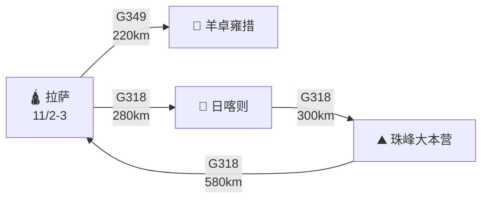

# 🟠 第三阶段·拉萨与延伸（Day 15-19）

**核心目标**：深度游览拉萨，并延伸至羊卓雍措、日喀则、珠穆朗玛峰。预留充足时间适应高原。

---

## 📊 阶段总览

<div class="stat-bar">
<div class="stat-item">
<div class="stat-value">5</div>
<div class="stat-label">天数</div>
</div>
<div class="stat-item">
<div class="stat-value">1,650</div>
<div class="stat-label">公里</div>
</div>
<div class="stat-item">
<div class="stat-value">3,650</div>
<div class="stat-label">拉萨海拔</div>
</div>
<div class="stat-item">
<div class="stat-value">5,248</div>
<div class="stat-label">最高点（嘉措拉）</div>
</div>
</div>

---

## 🗺️ 路线图



---

## 📅 每日行程

<div class="day-card">

### Day 15（11/2 周一）拉萨深度休整

**今日主题**：布达拉宫 + 大昭寺 + 八廓街

**行程**：

```
09:00 酒店早餐（早休息后起床）
10:00 **布达拉宫**（必看！）🌟🌟🌟
     - 门票：200元（旺季需提前 1 天预约）
     - 游玩时间：2-3 小时
     - 必看：白宫、红宫、达赖喇嘛灵塔
13:00 午餐（藏餐或中餐）
15:00 **大昭寺** 🌟🌟
     - 门票：85元
     - 游玩时间：1-2 小时
     - 释迦牟尼 12 岁等身像（藏族最珍贵）
     - 必看：金顶、八廓街转经
17:00 **八廓街**（免费）
     - 藏式商业街
     - 工艺品、唐卡、藏银
     - 体验转经
19:00 晚餐
20:00 **布达拉宫广场夜景**（免费）🌟
```

**充电**：

- 🟢 **拉萨理想5C超充**（白天多次补电）

**拉萨住宿推荐**（海拔 3650m）：

- **拉萨瑞吉度假酒店**（1500元/晚，顶级）🌟
- 拉萨香格里拉大酒店（800元/晚）
- 拉萨饭店（400元/晚，老牌）
- 平措康桑酒店（500元/晚）

**今日美食**：

- 🍵 **酥油茶**（藏式早餐必喝）
- 🥘 糌粑
- 🍖 牦牛肉（**玛吉阿米餐厅**，网红）
- 🍶 青稞酒

!!! warning "⚠️ 布达拉宫预约"
    - 旺季需提前 1 天官网预约
    - 每日限流 5000 人
    - 建议提前在"布达拉宫官方平台"预约

!!! tip "💡 高原活动原则"
    - 今日不安排剧烈活动
    - 多喝水（每天 3-4L）
    - 早休息（不超过 22:00）
    - 多监测血氧

</div>

<div class="day-card">

### Day 16（11/3 周二）拉萨 → 羊卓雍措 → 拉萨

**路线**：<span class="road-badge road-badge-g349">G349</span> → 曲水 → **岗巴拉山口（4990m）** → 羊湖 → 浪卡子 → 原路返拉萨

**里程**：约 220 km（往返）| **用时**：约 5 小时

**充电**：

- 出发前拉萨5C充满
- 山顶无充电桩

**沿途景点**：

**羊卓雍措** 🌟🌟🌟🌟（西藏三大圣湖之一）

- 门票：60元
- 游玩时间：2-3 小时
- 海拔：4990m（岗巴拉山口）
- 必拍：岗巴拉观景台俯瞰羊湖

**羊湖看点**：

- 湖水呈现多层蓝色（光合作用 + 矿物质）
- 岗巴拉山垭口观景台
- 湖畔藏式村庄
- 浪卡子县午餐（海拔 4450m）

**行程时间表**：

```
07:30 早餐
08:00 拉萨出发
10:00 岗巴拉山口（拍照 30 分钟）🌟
11:00 羊湖观景台（拍照 1 小时）
12:30 浪卡子县午餐
14:00 返回拉萨
16:30 抵达拉萨
```

**今日美食**：

- 🍖 浪卡子牦牛肉
- 🥛 酥油茶

!!! warning "⚠️ 羊湖高反"
    - 岗巴拉山口海拔 4990m，**接近极高反风险**
    - 停留时间不超过 1 小时
    - 慢走、不奔跑
    - 备好氧气

</div>

<div class="day-card">

### Day 17（11/4 周三）拉萨 → 日喀则

**路线**：<span class="road-badge road-badge-g318">G318</span> → 曲水 → 仁布 → 日喀则

**里程**：约 280 km | **用时**：约 5 小时

**充电**：

- 🟢 **日喀则环城路站**（理想5C）

**沿途景点**：

**扎什伦布寺** 🌟🌟🌟（必看！）

- 门票：100元
- 游玩时间：2-3 小时
- 藏传佛教**格鲁派六大寺之一**
- 历代**班禅**驻锡地
- 必看：强巴佛殿（26.2m 强巴铜像）、四世班禅灵塔

**行程时间表**：

```
08:00 拉萨出发
13:00 抵达日喀则
13:30 午餐
15:00 **扎什伦布寺**（必看）
18:00 日喀则古城闲逛
19:30 晚餐
```

**日喀则住宿**（海拔 3850m）：

- 日喀则唐拉雅秀酒店（500元/晚）
- 日喀则阳光大酒店（400元/晚）
- 日喀则桑珠孜大酒店（300元/晚）

**今日美食**：

- 🥘 日喀则糌粑
- 🍖 藏餐

</div>

<div class="day-card">

### Day 18（11/5 周四）日喀则 → 珠峰大本营 → 定日 / 日喀则

**路线**：<span class="road-badge road-badge-g318">G318</span> → 拉孜 → **嘉措拉山口（5248m）** → 珠峰保护区 → 珠峰大本营

**里程**：约 600 km（往返）| **用时**：约 10-12 小时

**充电**：

- 🟢 **日喀则环城路站**（理想5C，出发前充满）
- 定日县城第三方桩（应急）

**沿途景点**：

**嘉措拉山口** 🌟🌟（全程最高点）

- 海拔 5248m
- 离珠峰最近的垭口
- 风大、可能下雪

**珠穆朗玛峰大本营** 🌟🌟🌟🌟🌟（世界之巅！）

- 门票：180元（珠峰自然保护区）
- 车辆进山费：120元
- 观光车：120元
- 游玩时间：1-2 小时
- 必看：珠峰观景台、绒布寺、珠峰测量纪念碑
- 珠峰海拔：8848.86m

**行程时间表**：

```
05:30 早起，早餐
06:00 日喀则出发
09:30 拉孜午餐
10:00 嘉措拉山口（拍照 20 分钟）
12:00 抵达珠峰大本营
13:00 绒布寺 + 观景台
14:30 返程
20:00 抵达日喀则（或定日）
```

!!! danger "⚠️ 珠峰段风险"
    - 嘉措拉山口 5248m，**全程最高点**
    - 珠峰大本营海拔 5200m
    - **务必携带氧气袋**（每人 1 袋+）
    - 监测血氧（< 80% 立即下撤）
    - 路面颠簸，慢速行驶
    - 边防证必带

**住宿**：

- 选择 1：返回日喀则（舒适）
- 选择 2：定日县城（节省时间，但住宿条件一般）

**今日美食**：

- 🍖 珠峰牦牛肉
- 🍵 酥油茶

!!! tip "💡 珠峰小贴士"
    - **珠峰观景台** 实为加乌拉山观景台（5210m），可远眺 4 座 8000m+ 雪山
    - 真正的珠峰大本营已封闭
    - 最佳拍照：上午光线（下午多云）

</div>

<div class="day-card">

### Day 19（11/6 周五）日喀则 → 拉萨（返程休整）

**路线**：原路返拉萨

**里程**：约 280 km | **用时**：约 5 小时

**充电**：

- 🟢 **拉萨理想5C**（满电）

**今日主题**：返程休整，为 G317 长途准备

**行程**：

```
08:00 日喀则出发
13:00 抵达拉萨
14:00 午餐
15:00 拉萨自由活动
17:00 采购 G317 物资
19:00 晚餐
20:00 检查车辆
```

**G317 出发前准备**：

- ✅ 现金 2000+ 元
- ✅ 备用氧气袋
- ✅ 备用食品（能量棒、巧克力）
- ✅ 检查电量和胎压
- ✅ 准备防寒衣物
- ✅ 关注天气预报

**拉萨采购**：

- 牦牛肉干（送礼佳品）
- 藏红花（女性亲戚）
- 冬虫夏草（识货者）
- 唐卡（小件）
- 藏银饰品

!!! tip "💡 纳木措可选"
    如还有体力，可从当雄绕道 **纳木措**（距拉萨 240km）：

    - 纳木措：西藏第一大湖
    - 扎西半岛：最佳观景
    - 当雄县住宿：海拔 4300m
    - 但本行程选择 G317 主线，舍弃纳木措

</div>

---

## 🎯 拉萨深度游

### 拉萨必看 Top 8

| 景点 | 门票 | 推荐指数 | 备注 |
|------|------|----------|------|
| 布达拉宫 | 200 | ⭐⭐⭐⭐⭐ | 必看，提前预约 |
| 大昭寺 | 85 | ⭐⭐⭐⭐⭐ | 释迦牟尼12岁等身像 |
| 八廓街 | 免费 | ⭐⭐⭐⭐ | 藏式商业街 |
| 罗布林卡 | 60 | ⭐⭐⭐⭐ | 达赖夏宫 |
| 色拉寺 | 50 | ⭐⭐⭐⭐ | 辩经 |
| 哲蚌寺 | 50 | ⭐⭐⭐ | 规模大 |
| 药王山 | 免费 | ⭐⭐⭐ | 布宫取景地 |
| 西藏博物馆 | 免费 | ⭐⭐⭐ | 免费讲解 |

### 周边半日游

- **羊卓雍措**（Day 16 已去）
- **纳木措**（Day 19 可选）
- **甘丹寺**（格鲁派祖寺）
- **楚布寺**（噶玛噶举派主寺）

---

## ⚠️ G317 出发前重点

### 车辆

- 轮胎气压（高海拔轮胎压力变化）
- 刹车片（72道拐磨损）
- 备胎（**G317 沿途维修点少**）
- 机油（理想 1.5T 增程器）

### 人员

- 边防证检查
- 身份证备份
- 高反药品补给
- 现金

### 物资

- 备用氧气袋
- 能量食品
- 保暖衣物
- 应急救援卡

---

## ⏭️ 下一步

- 🟣 进入 [第四阶段·G317川藏北线](stage-4-g317.md)
- 🆘 查看 [应急与救援](emergency.md)
- 🏔️ 查看 [高反与健康](health.md)
