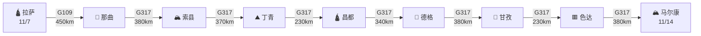
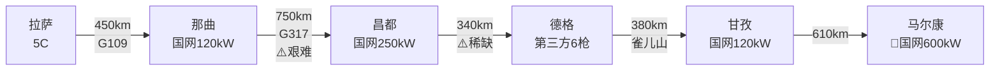

# 🟣 第四阶段·G317川藏北线（Day 20-27）

**核心目标**：G317川藏北线穿越，从拉萨经那曲、昌都、德格、色达到马尔康。8 天深入藏地，体验最原始的川藏线。

---

## 📊 阶段总览

8

天数

2,400

公里

5,050

雀儿山海拔

600kW

马尔康最强桩

---

## 🗺️ 路线图

---

## 🛣️ G317 核心道路解读

### G317 川藏北线

**总长**：2,030 km
**本程里程**：约 2,400 km（含绕道）
**特色**：🟣 更原始、更荒野、更深入藏地

**关键垭口**：

| 垭口 | 海拔 | 本日 | 难度 |
|------|------|------|------|
| 矮拉山 | 4245m | Day 24 | ⭐⭐ |
| 雀儿山 | 5050m | Day 25 | ⭐⭐⭐⭐ |
| 珠角拉山 | 4688m | Day 22 | ⭐⭐⭐ |
| 雅克夏雪山 | 4420m | Day 27 | ⭐⭐⭐ |
| 梦笔山 | 4114m | Day 27 | ⭐⭐ |

---

## 📅 每日行程

### Day 20（11/7 周六）拉萨 → 纳木措 → 那曲

**路线**：G109京拉线 → 当雄 → **纳木措**（绕道 60km）→ 那曲

**里程**：约 450 km（含绕道）| **用时**：约 8 小时

**充电**：

- 那曲国网 120kW 充电站

**沿途景点**：

**纳木措** 🌟🌟🌟🌟（西藏第一大湖）

- 门票：120元（旺季 5-10月），冬季免费
- 游玩时间：2-3 小时
- 海拔：4718m
- 必看：扎西半岛、合掌石
- "天湖"，与念青唐古拉山相望

**那曲住宿**（海拔 4500m，**全程最高住宿**）：

- 那曲饭店（400元/晚）
- 那曲大酒店（300元/晚）
- 那曲藏家乐（200元/晚）

!!! danger "⚠️ 那曲高反"
    海拔 4500m，**全程住宿最高点**。当晚务必：
    - 监测血氧
    - 多喝水
    - 不洗澡
    - 早休息
    - 准备氧气袋

### Day 21（11/8 周日）那曲 → 巴青 → 索县

**路线**：G317成那线 → 巴青 → 索县

**里程**：约 380 km | **用时**：约 7 小时

**充电**：

- 巴青 / 索县第三方桩（提前规划）

**沿途景点**：

- **藏北草原** 🌟（辽阔壮美）
- 措那湖（怒江源头，碧蓝小湖）
- 巴青草原

**索县住宿**（海拔 4000m）：

- 索县酒店（300元/晚，条件一般）
- 索县招待所（150元/晚）
- 藏式客栈（200元/晚）

**今日提示**：

- 段路偏远，加油站少
- 部分路段无信号
- 现金必备

### Day 22（11/9 周一）索县 → 类乌齐 → 丁青

**路线**：G317 → 巴青 → 类乌齐 → 丁青

**里程**：约 370 km | **用时**：约 7 小时

**充电**：

- 丁青第三方 120kW 充电站

**沿途景点**：

- **珠角拉山**（海拔 4688m）
- 类乌齐（类乌齐寺，藏传佛教噶举派）
- 丁青孜珠山（苯教圣山）

**丁青住宿**（海拔 3870m）：

- 丁青大酒店（300元/晚）
- 丁青藏式酒店（200元/晚）
- 丁青招待所（150元/晚）

### Day 23（11/10 周二）丁青 → 昌都

**路线**：G317

**里程**：约 230 km | **用时**：约 5 小时

**充电**：

- 昌都国网 120-250kW 充电站（**补给充足**）

**沿途景点**：

**强巴林寺** 🌟🌟🌟

- 门票：30元
- 游玩时间：2 小时
- 藏东最大寺庙
- 昌都格鲁派主寺
- 必看：强巴佛大殿、酥油花

**昌都市区**：

- 茶马古道重镇
- 澜沧江源头
- 卡若文化遗址

**昌都住宿**（海拔 3500m）：

- 昌都饭店（500元/晚）
- 昌都康巴酒店（300元/晚）
- 昌都藏式客栈（200元/晚）

**今日美食**：

- 🥘 昌都藏餐
- 🍖 牦牛肉火锅
- 🍵 酥油茶

!!! tip "💡 昌都补给"
    昌都是 G317 上最大的补给城市，建议：
    - **必须在此补满电**
    - **必须在此补足现金**
    - **必须在此补齐食品**
    - 德格段资源稀缺

### Day 24（11/11 周三）昌都 → 江达 → 德格

**路线**：G317 → 跨金沙江 → 江达 → 德格

**里程**：约 340 km | **用时**：约 6 小时

**充电**：

- ⚠️ **德格充电站**（第三方，**仅 3 站 6 枪**）
- **抵达后立即充电**

**沿途景点**：

**金沙江大桥**（川藏界）

- 西藏/四川分界
- 标志性建筑

**德格印经院** 🌟🌟🌟🌟（必看！）

- 门票：50元
- 游玩时间：2-3 小时
- 藏区三大印经院之首
- **雕版印刷**绝技（藏族活字印刷）
- 必看：印经工艺、《甘珠尔》《丹珠尔》经版

**德格住宿**（海拔 3260m）：

- 德格大酒店（300元/晚）
- 德格藏家乐（200元/晚）
- 德格招待所（150元/晚）

!!! danger "⚠️ 德格段风险"
    - 充电桩仅 3 站 6 枪，**故障率高**
    - 部分时段可能无桩可用
    - **昌都出发必须 100% 满电**
    - **德格抵达后立即充电**
    - 备好理想随车充（应急）

### Day 25（11/12 周四）德格 → 马尼干戈 → 甘孜

**路线**：G317 → **雀儿山（5050m，隧道已通）** → 新路海 → 马尼干戈 → 甘孜县

**里程**：约 380 km | **用时**：约 7 小时

**充电**：

- 甘孜县国网 120kW（10站30枪）

**沿途景点**：

**雀儿山隧道**

- 2017 年通车，全长 7 km
- 缩短行车 2 小时
- 海拔 5050m，**目前世界海拔最高公路隧道**

**新路海** 🌟🌟🌟

- 门票：20元
- 游玩时间：1 小时
- 又名"玉龙拉措"
- 雀儿山下翡翠湖

**马尼干戈草原**

- 藏族牧区风光
- 草原、河流、雪山

**甘孜住宿**（海拔 3400m）：

- 甘孜宾馆（300元/晚）
- 甘孜大酒店（400元/晚）
- 甘孜藏家乐（200元/晚）

**今日美食**：

- 🍖 甘孜藏餐
- 🍵 酥油茶

!!! warning "⚠️ 雀儿山驾驶"
    - 隧道内限速 40-60 km/h
    - 老路海拔高、条件差，**不推荐**
    - **隧道内禁止变道、超车**
    - 注意隧道入口/出口温差

### Day 26（11/13 周五）甘孜 → 炉霍 → 色达

**路线**：G317 → 炉霍 → 色达

**里程**：约 230 km | **用时**：约 4 小时

**充电**：

- 色达第三方 120kW（9站27枪）

**今日主攻：色达喇荣五明佛学院** 🌟🌟🌟🌟🌟（必看！）

**色达佛学院**：

- 门票：免费
- 游玩时间：3-4 小时
- **全球最大佛学院**
- 数千间绛红色僧舍铺满山坡
- 海拔 4000m

**必看**：

- 坛城（转经轮）
- 观景台（俯瞰全貌，**日落时分最佳**）
- 觉姆经堂
- 喇嘛经堂
- 辩经（上午）

**可选**：

- **天葬台**（藏区独特丧葬习俗）
  - 时间：下午 1-3 点
  - 尊重当地习俗
  - 不建议拍照

**色达住宿**（海拔 4000m）：

- 色达金马大酒店（300元/晚）
- 色达宾馆（250元/晚）
- 色达藏家乐（200元/晚）

**今日美食**：

- 🥘 色达藏餐
- 🍵 酥油茶

!!! warning "⚠️ 色达高反"
    - 海拔 4000m
    - 佛学院上坡路多，慢走
    - 备好氧气
    - 尊重僧侣，**禁止拍摄僧人**

### Day 27（11/14 周六）色达 → 壤塘 → 马尔康

**路线**：G317 → 壤塘 → **梦笔山（4114m）** → **雅克夏雪山（4420m）** → 马尔康

**里程**：约 380 km | **用时**：约 7 小时

**充电** 🌟：

- **马尔康高速路口停车场充电站**
- **国网 600kW 充电站**（**G317 全程最强**！）
- 马尔康维也纳酒店 Tesla 站（85kW，对外开放）

**沿途景点**：

**壤塘**

- 觉囊派文化中心
- 藏式建筑

**卓克基土司官寨** 🌟🌟

- 门票：50元
- 游玩时间：1-2 小时
- 《尘埃落定》取景地
- 嘉绒藏式建筑

**马尔康住宿**（海拔 2600m，**回归低海拔**）：

- 马尔康嘉绒大酒店（400元/晚）
- 马尔康维也纳酒店（500元/晚，**附 Tesla 站**）
- 马尔康宾馆（300元/晚）

!!! success "🎉 G317 阶段完成！"
    历经 8 天，从拉萨到马尔康。**最难关卡已过**。
    抵达马尔康后：
    - 海拔回到 2600m，可洗澡
    - 抵达后立即在 600kW 超充站充满
    - **为最后冲刺做准备**

---

## ⚡ G317 充电策略详解

### 三段难点

### 关键原则

1. **每站必充**：G317 充电桩少且不稳定
2. **关注App**：理想、特来电、e充电实时状态
3. **应急方案**：备理想随车充（220V 慢充，7kW）
4. **避雷暴**：高原天气多变
5. **夜间充电**：抵达酒店后立即充

---

## 🎯 G317 关键策略

### 每日充电节奏

| Day | 充电点 | 桩型 | 策略 |
|-----|--------|------|------|
| 20 | 那曲 | 120kW | 满电 |
| 21 | 索县 | 第三方 | 补电 |
| 22 | 丁青 | 120kW | 满电 |
| 23 | 昌都 | 250kW | **必满**（关键节点）|
| 24 | 德格 | 120kW | 立即满电 |
| 25 | 甘孜 | 120kW | 满电 |
| 26 | 色达 | 120kW | 满电 |
| 27 | **马尔康** | **600kW** | **狂补** |

### 应急方案

!!! tip "🆘 没电了怎么办"
    1. **保持冷静**，开启节能模式
    2. 找最近下撤点（那曲/昌都/马尔康）
    3. 致电理想救援：**400-686-9999**
    4. 启用增程器（强制保电模式）
    5. 找到就近充电桩或酒店插座

---

## ⏭️ 下一步

- 🟢 进入 [第五阶段·凯旋东归](stage-5-return.md)
- ⚡ 查看 [充电站网络](charging.md)
- 🆘 查看 [应急与救援](emergency.md)
