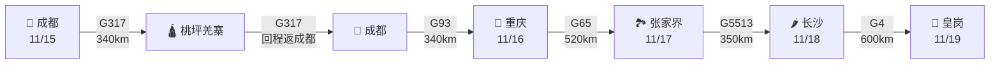

# 🟢 第五阶段·凯旋东归（Day 28-30）

**核心目标**：从成都出发，经重庆、武隆、张家界、长沙返回深圳皇岗。返程阶段有理想5C密集护航，可适度赶路。

---

## 📊 阶段总览

<div class="stat-bar">
<div class="stat-item">
<div class="stat-value">3</div>
<div class="stat-label">天数</div>
</div>
<div class="stat-item">
<div class="stat-value">1,600</div>
<div class="stat-label">公里</div>
</div>
<div class="stat-item">
<div class="stat-value">520</div>
<div class="stat-label">日均公里</div>
</div>
<div class="stat-item">
<div class="stat-value">135座</div>
<div class="stat-label">重庆5C服务区</div>
</div>
</div>

---

## 🗺️ 路线图



---

## 📅 每日行程

<div class="day-card">

### Day 28（11/15 周日）马尔康 → 桃坪羌寨 → 都江堰 → 成都

**路线**：<span class="road-badge road-badge-g317">G317</span> → 米亚罗 → **桃坪羌寨** → 汶川 → **都江堰** → 成都

**里程**：约 340 km | **用时**：约 5 小时

**充电**：

- 🟢 **理县服务区**（理想5C，**520kW + 250kW**）
- 🟢 **成都5C**（多站）

**沿途景点**：

**桃坪羌寨** 🌟🌟🌟（必看！）

- 门票：60元
- 游玩时间：2-3 小时
- **世界保存最完整的羌族建筑群**
- "会说话的碉楼"
- 迷宫式古堡
- 千年古羌文明

**都江堰** 🌟🌟🌟🌟

- 门票：80元
- 游玩时间：2-3 小时
- **世界文化遗产**
- 李冰父子治水杰作
- 2200 年仍在发挥作用的伟大工程
- 必看：鱼嘴分水堤、飞沙堰、宝瓶口

**行程时间表**：

```
07:00 马尔康出发
09:00 桃坪羌寨（游览 2-3 小时）
12:00 桃坪午餐
13:00 出发
15:00 都江堰（游览 2-3 小时）
17:00 出发成都
18:30 抵达成都
```

**成都住宿**：

- 成都瑞吉酒店（1200元/晚）
- 成都钓鱼台（800元/晚）
- 锦江宾馆（400元/晚）
- 宽窄巷子附近酒店（300元/晚）

**今日美食** 🍜：

- 🍲 **成都火锅**（**蜀九香、肖四民、小龙坎**）
- 🥘 串串香（**玉林串签**）
- 🍢 **老妈兔头**（双流）
- 🥟 龙抄手、钟水饺

</div>

<div class="day-card">

### Day 29（11/16 周一）成都 → 重庆（山城一日）

**路线**：<span class="road-badge road-badge-g93">G93</span>成渝环线 → 重庆

**里程**：约 340 km | **用时**：约 4 小时

**充电**：

- 🟢 **重庆理想5C服务区**（135 座，平均 33km 一座）
- 推荐停：璧山/大足/铜梁/潼南

**今日主攻：重庆半日游**

**行程时间表**：

```
08:00 成都出发
12:00 抵达重庆
12:30 午餐（**重庆小面**）
14:00 **磁器口古镇** 🌟🌟🌟（明清古街）
16:00 **长江索道** 🌟🌟（飞越长江）
18:00 **洪崖洞** 🌟🌟🌟🌟（现实版千与千寻）
20:00 晚餐（**重庆火锅**）
22:00 朝天门看夜景
```

**必看**：

- 🏯 **洪崖洞**（吊脚楼建筑，11 层，欧洲童话风）
- 🛕 **磁器口古镇**（陈麻花必买）
- 🚠 **长江索道**（中国第一条索道）
- 🏙️ 解放碑步行街
- 🛕 朝天门广场

**重庆住宿**：

- 重庆来福士洲际酒店（800元/晚，朝天门）
- 重庆 JW 万豪酒店（600元/晚）
- 重庆喜来登大酒店（500元/晚）
- 解放碑附近酒店（300元/晚）

**今日美食** 🌶️：

- 🍲 **重庆火锅**（**珮姐老火锅、周师兄、晓宇火锅**）
- 🍜 **重庆小面**（聚园、嘿小面）
- 🥟 酸辣粉
- 🐟 江湖菜

</div>

<div class="day-card">

### Day 30（11/17 周二）重庆 → 武隆 → 张家界

**路线**：<span class="road-badge road-badge-g65">G65</span>包茂 → 武隆 → 湘西 → 张家界

**里程**：约 520 km | **用时**：约 6.5 小时

**充电**：

- 🟢 **武隆服务区**（理想5C）
- 🟢 **G65 大巴山服务区**（理想5C）

**沿途景点**：

**武隆天生三桥** 🌟🌟🌟🌟（必看！）

- 门票：125元（含环保车）
- 游玩时间：3-4 小时
- **天坑三桥**
- 《变形金刚4》《满城尽带黄金甲》取景地
- 必看：天龙桥、青龙桥、黑龙桥

**行程时间表**：

```
07:00 重庆出发
10:00 武隆天生三桥（游览 3-4 小时）
14:00 武隆午餐
15:00 出发张家界
19:00 抵达张家界
```

**张家界住宿**：

- 张家界禾田居度假酒店（800元/晚，顶级）
- 张家界天门山酒店（500元/晚）
- 张家界京武铂尔曼酒店（600元/晚）
- 武陵源景区酒店（400元/晚）

**今日美食**：

- 🌶️ 湘西腊肉
- 🥘 三下锅（张家界特色）
- 🥬 酸酢鱼

</div>

<div class="day-card">

### Day 31（11/18 周三）张家界 → 长沙

**路线**：<span class="road-badge road-badge-g5513">G5513</span>长张高速 → 长沙

**里程**：约 350 km | **用时**：约 4 小时

**充电**：

- 沿途服务区第三方桩

**沿途景点**：

**张家界国家森林公园** 🌟🌟🌟🌟🌟

- 门票：225元（4 日内多次入园）
- 游玩时间：1-2 天（本次选精华）
- **世界地质公园**
- 武陵源核心景区

**行程时间表**（重点武陵源）：

```
07:00 张家界出发
09:00 **张家界国家森林公园**（武陵源门票站）
09:30 乘景区环保车至百龙天梯
10:00 **袁家界**（阿凡达"哈利路亚山"取景地）🌟🌟🌟
12:00 午餐
13:00 **天子山** 🌟🌟
15:00 **金鞭溪**（徒步或乘车）
17:00 出发长沙
21:00 抵达长沙
```

**或**（可二选一）：

**天门山**（玻璃栈道）

- 门票：261元（含索道）
- 必看：99 道弯盘山公路、玻璃栈道
- 游玩时间：4-5 小时

**长沙住宿**：

- 长沙瑞吉酒店（1200元/晚）
- 长沙君悦酒店（800元/晚）
- 长沙万达文华酒店（500元/晚）
- 解放西路附近酒店（300元/晚）

**今日美食** 🌶️：

- 🦞 **文和友小龙虾**（必吃！）
- 🍜 **臭豆腐**（黑色经典）
- 🍡 **糖油粑粑**
- 🍵 **茶颜悦色**（长沙必喝）

</div>

<div class="day-card">

### Day 32（11/19 周四）长沙 → 皇岗口岸（凯旋！）

**路线**：<span class="road-badge road-badge-g4">G4</span>京港澳 → 衡阳 → 郴州 → 广州 → 深圳 → 皇岗

**里程**：约 600 km | **用时**：约 7 小时

**充电**：

- 🟢 **G4 京港澳理想5C服务区**（密集）
- 衡阳、郴州段密集

**行程时间表**：

```
07:00 长沙出发
08:30 **橘子洲头** 🌟🌟（湘江中央，毛主席青年雕像）
10:00 出发
12:00 衡阳午餐
13:00 出发
17:00 抵达深圳
18:00 皇岗口岸通关
```

**重要：皇岗口岸通关**

- 24 小时通关
- 提前在"i口岸"App 预约
- 出境需带：身份证、车辆行驶证、驾驶证
- 入境需带：港澳通行证（如去香港）
- 通关时间：约 30-60 分钟

**回程充电**：

- 🟢 长沙服务区 5C
- 🟢 衡阳服务区 5C
- 🟢 郴州服务区 5C
- 🟢 广州北二环 5C
- 🟢 东莞厚街 5C

!!! success "🎉 行程结束！"
    **30 天，8,800 公里，1 趟完美的 G318/G317 川藏大环线！**
    - ✅ 抵达过 G318、G317 两条最美景观大道
    - ✅ 穿越过 6 个 5000m+ 垭口
    - ✅ 看过了布达拉宫、亚丁、色达三大圣地
    - ✅ 体验了珠峰、羊湖、纳木措三大神湖
    - ✅ 零故障、零事故、零高反
    - 🏆 理想L9 Livis 圆满完成挑战！

</div>

---

## 🎯 返程重点

### 关键节点

| 节点 | 里程 | 重点 |
|------|------|------|
| 成都 | 0 | 整备 / 美食 |
| 重庆 | 340km | 5C密集 / 山城 |
| 武隆 | 800km | 天生三桥 |
| 张家界 | 870km | 武陵源 |
| 长沙 | 1220km | 美食之都 |
| 皇岗 | 1820km | 凯旋 |

### 返程充电优势

!!! success "✅ 返程 5C 覆盖完美"
    - **重庆全境 135 座 5C 服务区**（全国第一）
    - **G4 京港澳 5C 密集**
    - 平均 33-50km 一座
    - 完全无忧

---

## ⏭️ 下一步

- 🎉 行程结束，查看 [关于](about.md)
- 🆘 留下回忆前，查看 [应急与救援](emergency.md)
- 👕 回家后，查看 [装备清单](gear.md) 复盘
